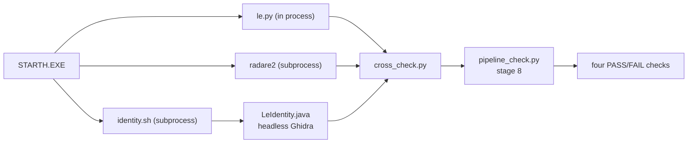

# Mandatory three-tool cross-check — Design

- **Date**: 2026-11-02
- **Status**: Implemented
- **Input**: "Implement mandatory cross-checks with all three tools
  (`tools/le.py`, Ghidra, and radare2)."

## Index

| Asset | Path | Purpose |
| --- | --- | --- |
| Design document | `design-mandatory-cross-checks.md` | This document |

The design defines no separate data model, contract file, or wireframe.
The identity model and the command contract are small and stay in this
document.

## Context And Problem

The project parses the DOS/4GW LE image with `tools/le.py` and disassembles
it with capstone. Ghidra and radare2 provide a second and a third view of
the same image. Today the views are not checked against each other on every
run:

- Stage 8 of `tools/pipeline_check.py` checks radare2 only when `r2` is on
  `PATH`. A host without radare2 prints a message and the stage adds no
  checks.
- `--skip-runtime` also skips stage 8, although the radare2 check is
  static.
- Ghidra runs only by hand through `tools/ghidra/decompile.sh`. No stage
  compares its view with the other two.
- `docs/reference/tooling.md` claims that the three views agree, but no
  automated stage enforces the claim.

A parser defect or a tool misconfiguration can therefore pass the pipeline.
The project needs one mandatory gate that compares the same identity facts
from all three tools.

## Goals And Non-Goals

### Goals

- Compare four identity facts from `le.py`, radare2, and Ghidra on every
  full pipeline run.
- Refuse to start when a mandatory tool is missing.
- Report one check per fact, so a disagreement names the failing fact.
- Keep the fast path available through an explicit flag.
- Keep the rebuild record store and its fingerprint unchanged.
- Add no new product dependency. Ghidra and radare2 stay verification
  tools.

### Non-Goals

- No function-count equality. The prologue scan finds 642 candidates and
  radare2 finds 923, so equality is not a valid rule.
- No instruction-level comparison. Ghidra applies the LE fixups and `le.py`
  does not, so byte or operand comparison is a different task.
- No automatic tool installation. The preflight reports the command, and
  the user runs it.
- No cross-check inside `tools/rebuild/run.py`. The rebuild identity engine
  stays with `le.py` and `diff_module.py`.
- No new record fields or schema change. The `le.py` helper change is a
  fingerprint input change. The next run re-verifies every record once.

## Requirements

### User Scenarios

#### Run the full check with all three tools (Priority: P1)

A developer runs the full pipeline inside the `cross-check` dev shell.

**Acceptance Scenarios**:

1. **Given** `r2`, Ghidra, and the loader extension are available,
   **When** the developer runs `pipeline_check.py`, **Then** stage 8 prints
   four `agree` lines and the run reports 61 checks.
2. **Given** the three tools agree, **When** the run ends, **Then** the exit
   code is 0.

#### Refuse to start when a tool is missing (Priority: P1)

A developer runs the full pipeline on a host without radare2 or Ghidra.

**Acceptance Scenarios**:

1. **Given** `r2` is not on `PATH`, **When** the developer runs
   `pipeline_check.py` without `--skip-cross`, **Then** the tool prints the
   `nix develop .#cross-check` command and exits 2 before any stage.
2. **Given** the Ghidra loader is not installed, **When** the developer runs
   the full check, **Then** the tool prints the `install_loader.sh` command
   and exits 2 before any stage.

#### Report a disagreement (Priority: P1)

One tool reports a different value for one fact.

**Acceptance Scenarios**:

1. **Given** Ghidra reports a different `main` entry, **When** stage 8 runs,
   **Then** the `main` check is FAIL, the other three checks keep their own
   verdicts, and the run exits 1.
2. **Given** a fact disagrees, **When** the developer reads the output,
   **Then** the line shows the value from each of the three tools.

#### Use the fast path (Priority: P1)

A developer wants the quick checks without Ghidra or radare2.

**Acceptance Scenarios**:

1. **Given** the host has no Ghidra or radare2, **When** the developer runs
   with `--skip-runtime --skip-cross`, **Then** the run reports 42 checks
   and exits 0.
2. **Given** `--skip-cross` is set, **When** the run starts, **Then** the
   preflight does not check Ghidra or radare2.

#### Diagnose one tool by hand (Priority: P2)

A developer wants the raw view of one tool.

**Acceptance Scenarios**:

1. **Given** the shipped executable, **When** the developer runs
   `cross_check.py` by hand, **Then** the tool prints four fact lines and
   exits 0, 1, or 2.
2. **Given** a failed run, **When** the developer reads
   `<work-root>/cross-check/`, **Then** the raw `r2.txt`, `r2.err`,
   `ghidra.txt`, `ghidra.err`, and `ghidra.log` outputs are present.

### Functional Requirements

- **FR-001**: The pipeline MUST require capstone, `r2`, and a working Ghidra
  setup before stage 1 when `--skip-cross` is absent.
- **FR-002**: The cross-check MUST compare four facts: the entry address,
  the page-0 file offset and module address, the `main` function entry, and
  the caller entry with its call site and target.
- **FR-003**: Each fact MUST be equal in all three tools. The compare MUST
  use integer equality. No tolerance is allowed.
- **FR-004**: `cross_check.py` MUST print exactly four fact lines on exit 0
  and exit 1. It MUST exit 0 on agreement, 1 on a difference or a tool
  failure, and 2 on invalid input or a missing tool. Exit 2 MAY print fewer
  than four lines.
- **FR-005**: Stage 8 MUST add exactly four checks, one per fact, even when
  a tool fails.
- **FR-006**: `--skip-runtime` MUST NOT skip stage 8. It MUST skip only
  stages 5, 6, 7, and 9.
- **FR-007**: `--skip-cross` MUST skip stage 8 and the tool preflight.
- **FR-008**: `flake.nix` MUST provide a `cross-check` dev shell with
  Python, capstone, radare2, Ghidra, `curl`, and `unzip`.
- **FR-009**: `install_loader.sh` MUST provide a `--check` mode.
  `identity.sh --check` MUST use it.
- **FR-010**: The unit suite MUST cover the parsers, the comparator, and
  the preflight without Ghidra, radare2, Docker, DOSBox-X, or the game.
- **FR-011**: The rebuild function records, the module records, and the
  record schema MUST NOT change. The `le.py` helper change alters the
  computed fingerprint, so the next verification run re-verifies every
  record once. The record files MUST NOT be rewritten by this change.
- **FR-012**: The documentation MUST state the four check counts and the
  mode that produces each count.
- **FR-013**: `le.py` MUST expose `function_starts()`,
  `nearest_function_start()`, and `capstone_available()`. The `funcs` and
  `near` command output MUST stay identical.
- **FR-014**: The pipeline MUST pass the `main` and call-site addresses from
  named constants next to `ENTRY_MODULE_LINEAR`.
- **FR-015**: The radare2 parser MUST select the `CALL XREF` line whose `@`
  address equals `--call-site`.
- **FR-016**: The preflight MUST check capstone before `r2` and Ghidra.
- **FR-017**: The caller MUST be derived from `--call-site`. The tool MUST
  NOT take a caller address on the command line.

## Assumptions And Constraints

- The shipped reference image is `STARTH.EXE`. The identity addresses are
  the current values: entry `0x300f8`, page 0 at file `0x1a800` and module
  `0x10000`, `main` at `0x10020`, and the caller at `0xd4324` with a call
  at `0xd4364` to `0x10020`.
- Ghidra is version 12.0.4. Version 12.1.x removes an API that the LX/LE
  loader uses.
- radare2 is version 6.2.4.
- The loader install needs network access and a writable home directory.
- The full check already needs Docker, DOSBox-X, the installed game, the
  reference executable, and a built `driver.exe` in `work/rebuild`.  Build
  the driver with
  `python3 tools/rebuild/harness.py build --module driver` before a full
  check on a clean `work/`.
- The full check takes about 8 minutes today. The Ghidra import adds time.
- The stage-11 count depends on Docker and the number of records with a
  stored result. The documented counts use the current 11 records.
- The `le.py` lookup for a caller uses the call site, not the caller
  address. `le.py near <caller>` misses the caller's own prologue because
  the search slice ends at the address.
- The pipeline holds `MAIN_LINEAR = 0x10020` and
  `MAIN_CALL_SITE = 0xD4364` as named constants next to `ENTRY_*`.
- The `le.py funcs` output is stable. The store seed reads it, so a helper
  refactor must not change the output.
- `le.py` is a fingerprint input (`store.TOOL_FILES`). The helper change
  changes every computed fingerprint. The first verification run
  re-verifies every record once. The record files do not change.
- The Ghidra external entry point iterator is expected to hold one address.
  The first implementation run confirms it. More than one address makes
  the `entry` fact `unknown`.
- `install_loader.sh --check` does not download. It reads the installed
  extension and its version.
- The Ghidra analysis and the loader install dominate the setup time. The
  first `cross-check` shell entry downloads a large Ghidra closure.
- The Ghidra `.image` block holds the raw file at file offset 0. The
  loader's object blocks come from a byte array and have no file source.
  The page-0 file offset comes from the LE page table in `.image`.
- Ghidra 12.0.4 appends ` (GhidraScript)` to each logged script line. The
  wrapper strips it.

## Approaches Considered

### Dedicated `tools/cross_check.py` — Recommended

- **Summary**: A new tool owns the identity set and the comparison. It uses
  `le.py` in process, starts radare2, and starts the Ghidra wrapper.
  `pipeline_check.py` calls the tool and turns the four lines into checks.
  The change adds three small public helpers to `le.py` but no `cross`
  command.
- **Trade-offs**: Adds three files and one subprocess boundary. In return,
  the comparison is reusable, testable without the orchestrator, and
  separate from the pipeline.
- **Decision**: Chosen. It follows the project rule that each tool handles
  one aspect.

### Inline stage in `pipeline_check.py`

- **Summary**: Add `check_three_way()` next to the radare2 stage.
- **Trade-offs**: Fewer files and the current stage style. The orchestrator
  grows, and a test needs the whole orchestrator.
- **Decision**: Rejected. The comparison logic would not be reusable.

### Extend `tools/le.py` with a `cross` command

- **Summary**: Add the comparison to the parser tool.
- **Trade-offs**: One entry point. `le.py` would depend on Ghidra and
  radare2 and would no longer hold only LE knowledge.
- **Decision**: Rejected. It breaks the single responsibility and the
  dependency direction.

### Identity set — Recommended

- **Summary**: Compare the entry, the page-0 mapping, `main`, and the
  caller.
- **Trade-offs**: Four stable facts. The set does not catch a function that
  one tool misses.
- **Decision**: Chosen. The parser and radare2 agree today, and the docs
  record the same values for Ghidra. The first implementation run confirms
  the Ghidra values before the gate becomes strict.

### Function containment or instruction stream

- **Summary**: Require every `le.py` function in the other tools, or compare
  the instructions.
- **Trade-offs**: Higher coverage. The function counts differ (642 against
  923), and Ghidra applies fixups, so the false-positive risk is high.
- **Decision**: Rejected for this change. A later change can add a
  normalized function census.

### Preflight refusal — Recommended

- **Summary**: Check `r2` and Ghidra before stage 1 and exit 2 when one is
  absent.
- **Trade-offs**: The run is never partly evaluated. No stage output appears
  when a tool is absent.
- **Decision**: Chosen. A missing tool is an input error, not a code
  failure.

### Stage failure or automatic provisioning

- **Summary**: Run the other stages and fail the cross-check, or install
  the tools from the stage.
- **Trade-offs**: Stage failure hides the input problem in check output.
  Provisioning needs network and a writable home and is slow and fragile.
- **Decision**: Rejected. The preflight reports the exact command instead.

## Architecture

### Components

| Component | Responsibility | Depends On |
| --- | --- | --- |
| `tools/le.py` | Parse the image and expose the function-start scan as public helpers | capstone |
| `tools/cross_check.py` | Own the identity set, normalize the three views, and compare them | `le.py`, `r2`, `identity.sh` |
| `tools/ghidra/identity.sh` | Run Ghidra headless and check the Ghidra setup | `analyzeHeadless`, `LeIdentity.java`, `install_loader.sh` |
| `tools/ghidra/LeIdentity.java` | Extract the four facts from the loaded program | Ghidra API |
| `tools/ghidra/install_loader.sh` | Install or check the LX/LE loader | network, Ghidra user directory |
| `tools/pipeline_check.py` | Preflight, stage 8, and the two skip flags | `cross_check.py` |
| `flake.nix` | Provide one shell with all three tools | `nixpkgs`, `nixpkgs-ghidra` |

### Diagram



### Data Flow

1. The preflight checks `le.capstone_available()`, `r2` on `PATH`, and
   `identity.sh --check`, unless `--skip-cross` is set.
2. `cross_check.py` loads the image with `le.py`. It reads the entry and the
   page-0 mapping. It reads the `main` start from `le.function_starts()` and
   the caller from `le.nearest_function_start()` at the call site.
3. `cross_check.py` runs radare2 and strips the ANSI escapes.
4. `cross_check.py` runs `identity.sh`, which imports the executable into
   `<work-root>/cross-check/ghidra/proj` and runs `LeIdentity.java`.
5. `cross_check.py` normalizes each value to an integer and compares the
   three views for each fact.
6. `cross_check.py` prints four lines in a fixed order and exits 0, 1, or 2.
7. `pipeline_check.py` parses the four lines and adds one check per fact.

## Component Interfaces

### `tools/le.py`

- **Purpose**: Parse the image and expose the function-start scan to the
  other tools.
- **Interface**:
  - `function_starts(exe, start=None, end=None, limit=10000) -> list[int]`
    returns the candidate starts of the entry object. It is the reusable
    form of the current `funcs` scan.
  - `nearest_function_start(exe, address) -> int | None` returns the
    candidate start nearest below an address. It is the reusable form of
    the current `near` scan.
  - `capstone_available() -> bool` returns true when the capstone library
    loads. It does not decode.
  - `print_functions()` and `print_nearest_function()` call the helpers.
- **Failure Modes**: An unmapped address or a missing entry object returns
  `None` or raises `ValueError`, as the current functions do. The `funcs`
  and `near` output does not change.

### `tools/cross_check.py`

- **Purpose**: Compare the identity facts from the three tools.
- **Interface**:
  ```text
  python3 tools/cross_check.py --original PATH
      --main 0x10020 --call-site 0xd4364
      [--work-root work] [--r2 r2] [--ghidra tools/ghidra/identity.sh]
  ```
  Output, in this order:
  ```text
  entry: agree le=0x300f8 r2=0x300f8 ghidra=0x300f8
  page0: agree le=0x1a800->0x10000 r2=0x1a800->0x10000 ghidra=0x1a800->0x10000
  main: agree le=0x10020 r2=0x10020 ghidra=0x10020
  caller: agree le=0xd4364@0xd4324->0x10020 r2=0xd4364@0xd4324->0x10020 ghidra=0xd4364@0xd4324->0x10020
  ```
  A differ line shows the value from each tool. The caller is derived from
  `--call-site`. The tool does not take a caller address.
- **Rules**:
  - `le.py`: `exe.entry_linear`; `exe.page_at(0x10000)`; the greatest
    `function_starts()` entry at or below `--main`;
    `nearest_function_start(callSite)` and the `call` target at the call
    site.
  - radare2: `ie`, `iS`, and `pdf`. Strip the ANSI escapes. In `pdf`, select
    the `CALL XREF from fcn.<caller> @ <call-site>` line whose `@` address
    equals `--call-site`. Zero or several matches make the caller
    `unknown`.
  - Ghidra: the seven `identity.sh` keys.
  - The compare is integer equality on every field of the fact.
- **Failure Modes**: A missing tool or an invalid address exits 2. A tool
  failure during the run exits 1. Raw stdout is saved in `r2.txt` and
  `ghidra.txt`, stderr in `r2.err` and `ghidra.err`, and the Ghidra log in
  `ghidra.log`, all under `<work-root>/cross-check/`.

### `tools/ghidra/identity.sh`

- **Purpose**: Run `LeIdentity.java` and check the Ghidra setup.
- **Interface**:
  - `identity.sh --exe PATH --project-dir DIR --main ADDR --call-site ADDR
    [--log PATH]`
  - `identity.sh --check`
- **Output**:
  ```text
  === identity
  entry=0x300f8
  page0_module=0x10000
  page0_file=0x1a800
  main=0x10020
  caller=0xd4324
  call_site=0xd4364
  call_target=0x10020
  ```
- **Rules**:
  - `--check` verifies `analyzeHeadless`, `GHIDRA_INSTALL_DIR`,
    `LeIdentity.java`, the loader extension, and the extension version. It
    does not download. It prints `ok` and the Ghidra version, then exits 0.
    Otherwise it prints the exact install command and exits 2.
  - A run filters the `=== identity` marker, strips the
    `INFO  LeIdentity.java> ` prefix and the optional ` (GhidraScript)`
    suffix, and checks all seven keys before it exits 0.
  - A run copies the full `analyzeHeadless` log to the `--log` path before
    it removes the project directory on failure.
- **Failure Modes**: A missing marker or key, or a Java `error:` line,
  makes the wrapper exit 2. It does not trust the `analyzeHeadless` exit
  code alone.

### `tools/ghidra/LeIdentity.java`

- **Purpose**: Extract the identity facts from the loaded program.
- **Interface**: Reads `--main` and `--call-site` from `getScriptArgs()` and
  converts them with `toAddr()`.
- **Rules**:
  - `entry`: the address from
    `getSymbolTable().getExternalEntryPointIterator()`. Exactly one address
    must be present. Zero or several addresses print `entry=unknown`.
  - `page0_module`: `0x10000`, the address being mapped.
  - `page0_file`: parse the LE object page table from the `.image` block.
    Read `e_lfanew` at file offset `0x3c`. Read the LE header at `e_lfanew`:
    `page_size` at `+0x28`, `object_table_offset` at `+0x40`,
    `object_page_table_offset` at `+0x48`, and `data_pages_offset` at
    `+0x80`. Read object 1 at `e_lfanew + object_table_offset` and take its
    `page_table_index` at `+0x0c`. Read the page-0 entry at
    `e_lfanew + object_page_table_offset + (page_table_index - 1) * 4` as a
    big-endian 32-bit value. The file page is `value >> 8`. The file offset
    is `data_pages_offset + (file_page - 1) * page_size`. A failed read or
    an invalid value prints `unknown`.
  - `main`: `getFunctionContaining(main).getEntryPoint()`.
  - `caller`: the entry point of `getFunctionContaining(callSite)`.
  - `call_target`: the target of the call at `callSite`.
- **Failure Modes**: An unresolved key prints `key=unknown`. A fatal
  condition prints `error: <message>` to stderr and throws. The script does
  not set the process exit code. The wrapper maps the error.

### `tools/ghidra/install_loader.sh`

- **Purpose**: Install or check the LX/LE loader.
- **Interface**:
  - `install_loader.sh` installs the loader into `GHIDRA_USER_DIR` or the
    OS default.
  - `install_loader.sh --check` verifies the extension, its
    `extension.properties` version, and the Ghidra version. It does not
    download. It prints the extension path and exits 0, or prints the
    install command and exits 2.
- **Failure Modes**: A missing `GHIDRA_INSTALL_DIR` or
  `Ghidra/application.properties` exits 2 with the path.

### `tools/pipeline_check.py`

- **Purpose**: Enforce the gate and report one check per fact.
- **Interface**:
  - `MAIN_LINEAR = 0x10020` and `MAIN_CALL_SITE = 0xD4364` are constants
    next to `ENTRY_MODULE_LINEAR`.
  - Stage 8 calls `cross_check.py` with `--original`, `--main`,
    `--call-site`, and `--work-root args.work_root`.
  - `--skip-runtime` skips stages 5, 6, 7, and 9. `--skip-cross` skips
    stage 8 and the tool preflight.
- **Failure Modes**: A missing capstone, `r2`, or Ghidra exits 2 before
  stage 1. A difference adds FAIL checks and the run exits 1. A missing
  fact line is FAIL. A cross-check return code outside 0 and 1 fails all
  four facts.

Skip modes:

| Mode | Stages 5, 6, 7, 9 | Stage 8 | Tool preflight |
| --- | --- | --- | --- |
| none | run | run | run |
| `--skip-runtime` | skip | run | run |
| `--skip-cross` | run | skip | skip |
| both | skip | skip | skip |

### `flake.nix`

- **Purpose**: Provide one environment with Python, capstone, radare2,
  Ghidra, `curl`, and `unzip`.
- **Interface**:
  ```nix
  packages = [
    pkgs.python3
    pkgs.capstone
    pkgs.radare2
    ghidraPkgs.ghidra
    pkgs.curl
    pkgs.unzip
  ];
  shellHook = ''
    export GHIDRA_INSTALL_DIR="${ghidraPkgs.ghidra}/lib/ghidra"
    export PATH="$GHIDRA_INSTALL_DIR/support:$PATH"
  '';
  ```
  Run it with `nix develop .#cross-check --command <command>`.
- **Failure Modes**: A host without Nix cannot enter the shell. The
  preflight reports the shell command when the tools are absent.

## Data Model

The identity model has one entity: `IdentityFact`.

| Field | Type | Rule |
| --- | --- | --- |
| `name` | string | One of `entry`, `page0`, `main`, `caller` |
| `tool` | enum | `le`, `r2`, or `ghidra` |
| `fields` | map | Fact-specific integer fields |
| `status` | enum | `agree` or `differ` |

Fact fields:

| Fact | Fields |
| --- | --- |
| `entry` | `entry` |
| `page0` | `page0_module`, `page0_file` |
| `main` | `main` |
| `caller` | `caller`, `call_site`, `call_target` |

Fact sources:

| Fact | `le.py` | radare2 | Ghidra |
| --- | --- | --- | --- |
| `entry` | `exe.entry_linear` | `ie` row of type `program`, `vaddr` | the one external entry point |
| `page0` | `page_at(0x10000)`: module `0x10000`, file offset | `iS` row `vaddr 0x00010000`: `paddr` and `vaddr` | the LE page table parse from `.image` |
| `main` | the greatest `function_starts()` entry at or below `--main` | `pdf` at `--main`: `fcn.00010020` | `main` |
| `caller` | `nearest_function_start(callSite)`, the `call` at the site | the `CALL XREF` line at `--call-site` | `caller`, `call_site`, `call_target` |

Every field must be equal in all three tools. The compare uses integer
equality. No tolerance is allowed. A tool that cannot resolve a field
prints `unknown`. An `unknown` field makes the fact `differ`.

## Error Handling And Edge Cases

| Condition | Behavior |
| --- | --- |
| capstone is absent | Preflight exits 2 with the shell command |
| `r2` is absent | Preflight exits 2 with the shell command |
| Ghidra or the loader is absent | Preflight exits 2 with the install command |
| Ghidra analysis fails | Stage 8 reports four FAIL checks and exits 1. The log is kept |
| Ghidra prints `error:` | `identity.sh` exits 2, stage 8 reports four FAIL checks |
| A tool writes an error to stderr | `cross_check.py` saves `r2.err` or `ghidra.err` and keeps `ghidra.log` |
| The cross-check exits 2 or higher | Stage 8 fails all four facts |
| A fact differs | The fact line says `differ`, stage 8 fails that check |
| A key is unresolved | The value is `unknown`, the fact is `differ` |
| An address is not mapped | `cross_check.py` exits 2 with the address |
| Several `CALL XREF` lines | Select the line at `--call-site` |
| Ghidra returns several entry points | `entry=unknown`, the fact is `differ` |
| radare2 adds ANSI escapes | Strip them before the parse |
| Ghidra logs hide the output | Require the `=== identity` marker |
| Ghidra runs too long | Timeout at 1800 seconds, report the timeout |
| The `le.py funcs` output changes | The regression test fails before a seed run |
| `--skip-cross` is set | No tool preflight, no stage 8, no tool output |

## Non-Functional Requirements

- **Performance**: The Ghidra run dominates. The stage uses a dedicated
  project and imports with `-overwrite`. The fast path avoids both tools.
- **Determinism**: The compare uses integers. The output order is fixed.
  The Ghidra project is disposable and lies under
  `<work-root>/cross-check/`.
- **Observability**: Each fact line names the fact and the value from each
  tool. The raw outputs `r2.txt`, `r2.err`, `ghidra.txt`, `ghidra.err`, and
  `ghidra.log` stay under `<work-root>/cross-check/`.
- **Portability**: The loader check reuses the OS-specific logic in
  `install_loader.sh`. The tool paths come from the command line or
  `PATH`.

## Testing Strategy

- Unit tests cover the three parsers, the comparator, the CLI errors, and
  the preflight. They use fixtures and mocks. They need no Ghidra, no
  radare2, no Docker, no DOSBox-X, and no game directory.
- A `le.py` regression test locks the `funcs` and `near` output. The helper
  refactor must not change it, because the store seed reads `funcs`.
- A preflight test mocks `le.capstone_available()` and `shutil.which`.
- The radare2 parser test includes two `CALL XREF` lines and selects the
  one at `--call-site`.
- The Ghidra parser test includes zero and two entry points and expects
  `unknown`.
- The wrapper test includes the ` (GhidraScript)` suffix and expects the
  suffix to be stripped.
- The cross-check tests cover a missing entry object, a saved stderr, and a
  return code outside 0 and 1.
- A shell test covers `install_loader.sh --check` with a temporary
  `GHIDRA_INSTALL_DIR`, a fake `Ghidra/application.properties`, a temporary
  `GHIDRA_USER_DIR`, and a fake extension.
- A pipeline test covers the four fact lines, including a missing line.
- The real three-tool run is the integration test. It records the four
  `agree` lines in `docs/explanation/findings.md`.
- The existing preflight tests stay valid. The input checks run before the
  tool preflight.

Manual verification:

```sh
nix develop .#cross-check --command sh tools/ghidra/install_loader.sh
nix develop .#cross-check --command python3 tools/cross_check.py \
    --original ~/Documents/Screamer.app/Contents/Resources/game/STARTH.EXE \
    --main 0x10020 --call-site 0xd4364 --work-root work
python3 tools/rebuild/harness.py build --module driver
nix develop .#cross-check --command python3 tools/pipeline_check.py \
    --game-dir ~/Documents/Screamer.app/Contents/Resources/game
python3 tools/pipeline_check.py \
    --game-dir ~/Documents/Screamer.app/Contents/Resources/game \
    --skip-runtime --skip-cross
```

## Rollout And Compatibility

- The full check becomes stricter. A host without capstone, radare2, or
  Ghidra fails the preflight.
- The old fast command `--skip-runtime` no longer skips stage 8. A user who
  wants the old behavior adds `--skip-cross`.
- The documented counts change from "57, or 61 with radare2" to four
  explicit modes: 61 full, 57 with `--skip-cross`, 46 with `--skip-runtime`,
  and 42 with both.
- The self-hosted CI runner needs Nix and the loader. The pipeline job stays
  disabled until the runner has this setup.
- The `le.py funcs` and `near` output does not change. The store seed and
  the record extents are unaffected.
- `cross_check.py` derives the caller from `--call-site`. The tool has no
  caller argument.
- No record or schema migration is necessary. The `le.py` change alters the
  computed fingerprint, so the next verification run re-verifies every
  record once. The record files stay unchanged.

## Risks

| Risk | Impact | Mitigation |
| --- | --- | --- |
| Ghidra analysis is slow | The full check takes longer | Dedicated project, 1800 s timeout, `--skip-cross` fast path |
| Loader install needs network | A clean runner fails the preflight | `install_loader.sh --check` prints the command, the runner installs once |
| Ghidra 12.1 breaks the loader | The stage cannot run | Keep the 12.0.4 pin, print the version in `--check` |
| The Ghidra analysis yields different boundaries | A false positive on `main` or `caller` | The first implementation run records the real values. If they differ, stop and record a finding. Do not weaken the fact without a design change |
| The Java page-table parse differs from `le.py` | The `page0` fact fails | The first real run compares it with `le.py` and radare2. A mismatch is a finding |
| Ghidra returns several entry points | The `entry` fact is `unknown` | Fail the fact and record the iterator in the findings |
| The `le.py` helper refactor changes the scan | The store seed and the record extents change | A regression test locks the `funcs` output. Run the seed only after the test passes |
| The `le.py` change invalidates the stored fingerprints | The next run re-verifies every record | Expected. The record files stay unchanged. The run reports the recomputed fingerprints |
| A timed-out Ghidra run leaves a project lock | The next run fails | Remove the project directory on failure. Run one cross-check per work root |
| radare2 text format changes | The parser fails | Pin 6.2.4 and fail loudly |
| `identity.sh` masks a Ghidra failure | A false pass | Require the marker and all seven keys |
| The shell mixes two nixpkgs revisions | A larger closure | Keep the default shell light and use the cross-check shell only for the full run |
| The loader has no checksum | Supply-chain exposure | Existing behavior. Out of scope for this change |
| `--skip-cross` is used by habit | The gate is bypassed | The flag is explicit, and the docs name it as a reduced mode |

## Open Questions

None.

## Success Criteria

- **SC-001**: The full run prints four `agree` lines and 61 checks when
  Docker and the current 11 result-bearing records are present, and it exits
  0.
- **SC-002**: A missing capstone, Ghidra, or radare2 exits 2 before stage 1
  with the exact shell or install command.
- **SC-003**: `--skip-runtime --skip-cross` reports 42 checks and needs no
  Ghidra or radare2.
- **SC-004**: `python3 -m unittest discover -s tools/rebuild/tests` passes
  on a host without the tools or the game.
- **SC-005**: `README.md`, `AGENTS.md`, `docs/reference/tooling.md`, and
  `docs/explanation/findings.md` state the same four counts and modes.
- **SC-006**: No function record field, module record, or record schema
  changes. The computed fingerprints change because `le.py` changes, and
  the next run re-verifies every record once.
- **SC-007**: The `le.py funcs` and `near` output is byte-identical before
  and after the helper refactor.
- **SC-008**: `cross_check.py` derives the caller from `--call-site` and
  has no caller argument.
- **SC-009**: The preflight checks capstone, radare2, and Ghidra in that
  order.
