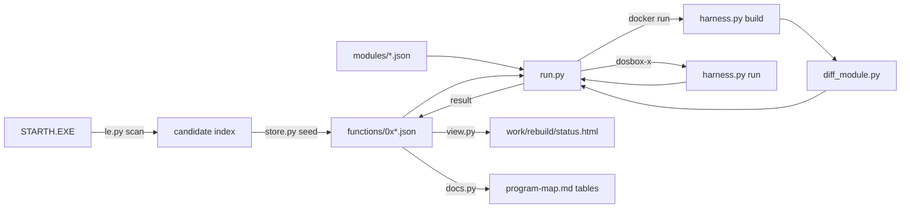

# Rebuild instrumentation — Design

- **Date**: 2026-10-26
- **Status**: Implemented
- **Input**: "Brainstorm an instrumentation framework for the rebuild
  procedure: a database-like structure for every function with its status,
  its identity percentage, and its notes, a web view of the project state,
  and a test-like orchestration that prints `Testing function 13 of 155 --
  function_name: PASS`."

## Index

| Asset | Path | Purpose |
| --- | --- | --- |
| Design document | `design-rebuild-instrumentation.md` | This document |
| Data model | [`data-model.md`](design-rebuild-instrumentation/data-model.md) | The function record, the module record, the status ladder, the validation rules, and the data flow |
| Contract: function record | [`tools/rebuild/contracts/record.schema.json`](../../tools/rebuild/contracts/record.schema.json) | JSON Schema of `functions/0x*.json` |
| Contract: module record | [`tools/rebuild/contracts/module.schema.json`](../../tools/rebuild/contracts/module.schema.json) | JSON Schema of `modules/*.json` |
| Wireframe: status view, default state | [`wireframes/status-view-default.html`](design-rebuild-instrumentation/wireframes/status-view-default.html) | The approved layout D of the status view |

## Context And Problem

The rebuild campaign keeps its state in three places that disagree.

- `docs/reference/program-map.md` holds 153 hand-written rows with 139
  names and a confidence label. It carries no rebuild status.
- `tools/pipeline_check.py` holds the `REBUILT_MODULES` tuple. It is the
  only machine-readable registry, and it covers four modules.
- `docs/explanation/findings.md` holds the status as prose.

A person cannot see the state of the whole program. The prologue scan finds
642 candidates and radare2 finds 923, so the total is unknown. There is no
identity percentage, no per-function note, and no way to run the tests in a
sequence with progress. The campaign needs one source of truth, one runner,
and one view.

## Goals And Non-Goals

### Goals

- One committed record per function of `STARTH.EXE`, with its name, its
  status, its notes, its evidence, its declared checks, and its last result.
- One canonical candidate list, seeded from the original image and grown
  through a reviewable diff.
- One command that builds and tests the declared checks, prints one progress
  line per function, and writes the result through the store.
- One self-contained HTML page that shows the state of the project.
- Generated function tables in `program-map.md`, with a drift check.
- No new dependency.

### Non-Goals

- No live server and no database.
- No graphical editor for a record. The command line edits a record.
- No parallel test run. A later change adds it when the module count grows.
- No build cache. A later change adds it when a full run takes too long.
- No new format claims. The framework records status, not file formats.
- No tracking of data objects. The program map holds code first.

## Requirements

### User Scenarios

#### Test the rebuilt modules with progress (Priority: P1)

A person rebuilds a function and tests it. The person wants one line per
function with the counter, the address, the name, and the verdict.

**Acceptance Scenarios**:

1. **Given** the seeded store, **When** the person runs `run.py run --all`,
   **Then** the tool prints one line per selected record in the form
   `[13/642] 0x300ec free: PASS (instructions 3/3, bytes 6/9)` and a
   summary.
2. **Given** a record with no name and a record with no declared check,
   **When** the person runs `run.py run --all`, **Then** the lines read
   `[16/642] 0x15570 (unnamed): SKIP (no name)` and
   `[17/642] 0x2ecf8 list_create: SKIP (no checks declared)`.
3. **Given** a record whose declared check fails, **When** the run ends,
   **Then** the exit code is 1, and the record keeps its previous status.

#### See the state of the project (Priority: P1)

A person wants the state of the whole program without the game files.

**Acceptance Scenarios**:

1. **Given** the seeded store, **When** the person runs `view.py html`,
   **Then** the page holds one row per record with the name, the status,
   the module, both percentages, and the stale mark.
2. **Given** a record whose source changed after the last run, **When** the
   page renders, **Then** the row carries the stale mark.

#### Recover a name and record it (Priority: P1)

A person recovers the name and the role of a candidate.

**Acceptance Scenarios**:

1. **Given** an unnamed candidate at `0x15570`, **When** the person runs
   `store.py set --function 0x15570 --name ... --role ... --evidence ...`,
   **Then** the record holds the name, and `docs.py render` writes the row
   into `program-map.md`.
2. **Given** the rendered page, **When** the person runs `docs.py check`,
   **Then** the tool reports no drift.

#### Keep the page and the store in step (Priority: P2)

**Acceptance Scenarios**:

1. **Given** a hand edit of the generated tables, **When** the person
   runs `docs.py check`, **Then** the tool reports the drift and exits 1.

#### Mark a candidate that is not a function (Priority: P2)

**Acceptance Scenarios**:

1. **Given** a prologue-scan candidate that is not a function start,
   **When** the person runs `store.py set --function 0x... --status
   not_a_function --note ...`, **Then** the view shows the mark, and the
   candidate leaves the progress total.

### Functional Requirements

- **FR-001**: The store MUST hold one record per function, one JSON file
  per record, named after the module linear address.
- **FR-002**: The store MUST be the only source of truth for identity,
  status, notes, evidence, declared checks, and results.
- **FR-003**: `store.py seed` MUST derive the candidate list from the
  original image and MUST NOT rewrite an existing record.
- **FR-004**: `store.py check` MUST reject a record that breaks an
  invariant, and MUST report a status stronger than the last result supports.
- **FR-005**: `run.py` MUST run the declared checks of every selected
  record, print one progress line per record, and write the result through
  the store.
- **FR-006**: `run.py` MUST exit 1 when a declared check fails, and it MUST
  write the status that `advance_status` gives: a skip or a failed build keeps
  the previous status, and a failed identity gives `rebuilt`.
- **FR-007**: `run.py --no-write` MUST leave the store unchanged.
- **FR-008**: The status page MUST mark a record stale when the source
  digest in its last result differs from the digest of its current module
  sources.  The runner MUST count a record as stale when the input fingerprint
  in its last result differs from the fingerprint of the current inputs, and
  `run.py --skip-unchanged` MUST run no check for an unchanged record.
- **FR-009**: `view.py` MUST write one self-contained HTML page. The page
  MUST hold no external reference and MUST need no server.
- **FR-010**: `docs.py render` MUST write the function tables of
  `program-map.md`, and `docs.py check` MUST fail on drift.
- **FR-011**: `harness.py` MUST hold every fact about the pinned
  container and DOSBox-X. No tool MAY call Docker, and no tool other than
  `dosboxx_control.py` MAY launch DOSBox-X.
- **FR-012**: The framework MUST use the Python standard library only.
- **FR-013**: The framework MUST NOT modify the shipped artifacts. It MUST
  write only under `work/` or to an explicit output path.
- **FR-014**: The standard-library `unittest` suite MUST cover the pure
  logic: the status advance, the percentages, the staleness compare, the
  validation, the seed diff, the selection, the progress line, the summary,
  and the table grouping.
- **FR-015**: `pipeline_check.py` MUST use the store as the module
  registry and MUST run `run.py run --all --no-write --skip-unchanged`. It MUST
  pass `--skip-runtime` when it skips the run-time stages. It MUST compare the
  printed verdict of each record that ran with the recorded result, and it MUST
  verify the stored fingerprint of an unchanged record itself, so a known
  difference passes and a change fails. It MUST fail on an unexpected skip
  of a named record.
- **FR-016**: A module record MUST hold its own status, checks, and result
  when it holds no function record of `STARTH.EXE`, for example the driver.

## Assumptions And Constraints

- The store lives in git and diffs line by line, so the shape is one JSON
  file per function.
- The file set is the canonical candidate list. The seed is the only writer
  of a new record, so the total changes only through a reviewable diff.
- The total is a file count, not a scan count. The prologue scan finds 642
  candidates (`findings.md`), so the seeded store holds about 642 records.
  The examples use 642, and the real total is the record count of the store.
- The pinned OpenWatcom V2 container and DOSBox-X stay the execution
  engines. The framework drives them and does not replace them.
- A tool runs and exits. It starts no background process.
- The identity percentage is derived from the counts of the last result. The
  store never holds a hand-entered percentage.
- The prose of `program-map.md` stays hand-written. The function tables
  become generated.
- The migration reads the hand-written `program-map.md` once. The plan
  removes the importer after the migration.
- Python 3.14.7. The framework imports the standard library and `ctypes`
  only.

## Approaches Considered

### One JSON file per candidate, the store as the registry — Recommended

- **Summary**: One committed file per candidate under
  `tools/rebuild/functions/`. The file holds the name, the role, the
  status, the notes, the evidence, the declared checks, and the last
  result. `store.py` is the only writer. `run.py` tests a selection and
  writes the result through `store.py`. `view.py` renders the page, and
  `docs.py` renders the tables of `program-map.md`.
- **Trade-offs**: The repository gains about 642 small files, and a hand edit
  of JSON is unpleasant. In return the total is a file count, a new
  candidate is a reviewable diff, a rename is a one-line diff, and the file
  set is the registry.
- **Decision**: Chosen. The user selected this shape. The design follows the
  established practice in decompilation projects, where a progress page
  reports one match percentage per function. (Inference from general
  practice, not verified in this repository.)

### A sparse store with a derived index — Rejected

- **Summary**: Only an annotated function gets a file. A tool derives the
  candidate list at view time.
- **Trade-offs**: Far fewer files, but the total comes from a scan, so the
  number changes between two runs without a diff.
- **Decision**: Rejected. The user chose one file per candidate, because the
  total must be real.

### A SQLite store under `work/` with a JSON seed in git — Rejected

- **Summary**: The live store is a SQLite file under `work/`, and a
  committed JSON seed rebuilds it.
- **Trade-offs**: Real queries, but the live state leaves git, and git
  cannot diff or merge a binary file.
- **Decision**: Rejected. A reviewer must see a status change in a diff.

### A Rust implementation of the framework — Rejected

- **Summary**: One Rust crate holds the store, the runner, the view, and
  the documentation renderer. `le.py`, `diff_module.py`, and
  `dosboxx_control.py` stay Python and become a text protocol, because
  every heavy operation is an external Docker build or a DOSBox-X session.
- **Trade-offs**: Typed records, so a bad status cannot compile, and
  `cargo test` as a built-in runner. In return: a second toolchain in
  `flake.nix` and CI, a `target/` tree to keep out of
  git, `serde` and `serde_json` as new dependencies against the
  one-dependency rule, a second language in the Code Guidelines, and a text
  protocol that breaks the Rust side on a wording change in Python. The
  Python alternative already covers the typed-record benefit with
  `store.py check`, the JSON Schema contract, and `test_store.py`.
- **Decision**: Rejected. The framework waits on subprocesses and holds
  about 1,000 lines of glue, so Rust buys little and costs a second
  toolchain. The deferred parallel run does not tip the balance, because the
  work is subprocess-bound and Python threads release the GIL. Revisit this
  decision when the framework becomes a long-lived program (a server or a
  scheduler), or when the tools must ship as one binary to a machine without
  Python. The store stays language-neutral JSON, so a later port changes no
  record.

## Architecture

### Components

| Component | Responsibility | Depends On |
| --- | --- | --- |
| `tools/rebuild/functions/0x*.json` | The store: one record per function | — |
| `tools/rebuild/modules/*.json` | The build and run recipe per module | — |
| `tools/rebuild/store.py` | The record schema, the read, the write, the validation, the seed, and the edits | `le.py` |
| `tools/rebuild/harness.py` | Build one module in the container. Run one module in DOSBox-X. | `dosboxx_control.py` |
| `tools/rebuild/run.py` | Select records, run the declared checks, print progress, write results | `store.py`, `harness.py`, `diff_module.py` |
| `tools/rebuild/view.py` | Render the self-contained HTML page | `store.py` |
| `tools/rebuild/docs.py` | Render the `program-map.md` tables. Check for drift. | `store.py` |
| `tools/rebuild/diff_module.py` | The identity engine. The byte and instruction compare lines print on every path, so the counts are always available. | `le.py` |
| `tools/le.py` | The candidate scan and the disassembly, unchanged | capstone |
| `tools/pipeline_check.py` | The repository-wide checks | Every tool |

Two boundaries keep the design honest.

- `store.py` is the only writer of the store, and `run.py` writes only
  through it. No other tool reads or writes the JSON of a record.
- `harness.py` holds every fact about Docker and DOSBox-X. `run.py` holds
  every fact about selection, order, and reporting.

The store adds one row to the layer table of `AGENTS.md`: the Store layer
holds the identity, the status, and the evidence per function, and it sits
between the Tools layer and the Documentation layer.

### Diagram

### Data Flow

1. `store.py seed` scans `STARTH.EXE` with the prologue scan of `le.py`
   and writes one record for each new candidate.
2. A person recovers a name and a role, and records them with
   `store.py set`.
3. `run.py` selects the records, and `harness.py` builds the module of
   each record in the pinned container.
4. `run.py` calls `diff_module.py` with the module map and the function
   symbol, and `harness.py run` drives the DOSBox-X harness for a
   declared behavior check.
5. `run.py` writes the result through `store.py`, prints the progress
   line, and keeps the full log under `work/rebuild/logs/`.
6. `view.py` renders the page from the store, and `docs.py` renders the
   tables of `program-map.md` from the store.

## Component Interfaces

### store.py

- **Purpose**: Hold the store: the schema, the read, the write, the
  validation, the seed, and the edits.
- **Interface**:
  - `store.py seed [--check]` writes a record for each new candidate and
    reports the added and the lost candidates. `--check` writes nothing and
    exits 1 on a difference. The seed calls `le.py funcs` with a limit above
    the candidate count, because the default limit of 500 caps the total.
  - `store.py set --function ADDR [--name NAME] [--role TEXT]
    [--status STATUS] [--module NAME] [--symbol SYM] [--section NAME]
    [--confidence C] [--check build|identity|behavior]
    [--evidence command|finding|file TEXT] [--note TEXT]`
  - `store.py note --function ADDR --text TEXT`
  - `store.py list [--status STATUS] [--module NAME] [--json]`
  - `store.py check` proves every invariant of the model and reports a
    status stronger than the last result supports.
  - Library: `load_record`, `save_record`, `save_result`, `load_module`,
    `candidate_addresses`, `advance_status`, `is_stale`, `source_digest`.
- **Failure Modes**: A broken record raises `ValueError` with the file path
  and the field. The seed never rewrites a record. A failed save leaves the
  previous file.

### harness.py

- **Purpose**: Build one module in the pinned container and run one module
  in DOSBox-X. Hold every fact about both.
- **Interface**:
  - `harness.py build --module NAME` copies the sources, compiles them
    with the recipe, and links the executable. It exits 1 on a compile or a
    link error, and it prints the container output.
  - `harness.py run --module NAME [--show]` writes the conf and the
    debugger script under `work/rebuild/`, allocates a free port, drives
    `dosboxx_control.py`, and compares the output with the expected lines.
  - `harness.py digest --module NAME` prints the SHA-256 of the sources.
  - The shared harness sources (`chk.asm`, `stack.asm`, `cstart.c`) are
    constants of this tool.
- **Failure Modes**: A missing Docker or DOSBox-X yields a skip, not a
  failure. A compile, a link, or a behavior difference exits 1 with the
  output.

### run.py

- **Purpose**: Select records, run their declared checks, print progress,
  and write the results.
- **Interface**:
  - `run.py run (--function ADDR | --name NAME | --module NAME |
    --status STATUS | --stale | --next N | --all) [--no-write] [--show]
    [--skip-runtime] [--skip-unchanged]`
  - The selection runs in address order. Without a selection flag the tool
    prints a clear error and exits 2.
  - `--next N` selects the N records of the smallest `size` among the
    records whose status is `named`. A record with no `size` goes last. An
    empty selection is a clear message, not an error.
  - `--module NAME` selects the function records of the module. When the
    module holds no function record, it selects the module row, for example
    `driver`, and the progress line reads `[1/1] driver: PASS (behavior)`.
  - `--skip-runtime` skips the behavior checks, so a run needs Docker only.
    The pipeline check passes it when it skips the run-time stages.
  - `--skip-unchanged` reports a record whose input fingerprint still matches
    the fingerprint of its recorded result with `PASS` and runs no check for
    it. A record without a recorded result or without a stored fingerprint
    always runs. `--stale` selects the records whose fingerprint differs.
  - The identity check passes when `diff_module.py` exits 0 and the verdict
    line names one of the three matches. The check result holds the verdict
    line in `detail`.
  - The library holds the selection, the progress line, and the summary in
    pure functions, so the unit tests exercise them without Docker.
- **Failure Modes**: A failed declared check exits 1 and writes the
  `advance_status` status. A skip or a failed build keeps the previous status.
  A missing module yields a skip. An interrupted run keeps every finished
  result.

### view.py

- **Purpose**: Render the self-contained HTML page of the store.
- **Interface**: `view.py html [--out PATH]` writes
  `work/rebuild/status.html` by default.
- **Failure Modes**: A broken record raises `ValueError` with the file path.

### docs.py

- **Purpose**: Render the function tables of `program-map.md` and check
  the drift.
- **Interface**: `docs.py render` writes the tables between the markers.
  `docs.py check` writes nothing and exits 1 on drift. The render
  reproduces the column set of each section. The startup table derives the
  run-time address as the load base `0x1c2000` plus the module linear
  address.
- **Failure Modes**: A missing marker raises `ValueError`. A record with an
  unknown section goes to the last table.

## Data Model

The store holds a function record per candidate and a module record per
build unit. The full model, the validation rules, and the lifecycle live in
[`data-model.md`](design-rebuild-instrumentation/data-model.md).

The status ladder is ordered. A run advances a record. A person sets the
first three statuses.

| Status | Meaning | Set By |
| --- | --- | --- |
| `unknown` | A candidate from the scan, nothing recovered | Seed |
| `not_a_function` | The scan false positive, terminal | A person |
| `named` | The name and the role are recovered | A person |
| `rebuilt` | A source exists and it builds | `run.py` |
| `matching` | The instruction sequences match | `run.py` |
| `verified` | Every declared check passes, `identity` included | `run.py` |

## API Contracts

| Contract | Path | Consumer |
| --- | --- | --- |
| Function record | [`tools/rebuild/contracts/record.schema.json`](../../tools/rebuild/contracts/record.schema.json) | `store.py`, `run.py`, `view.py`, `docs.py`, the tests |
| Module record | [`tools/rebuild/contracts/module.schema.json`](../../tools/rebuild/contracts/module.schema.json) | `harness.py`, `run.py` |

`test_store.py` compares the property names and the required set of every
record with the schema, so the contract cannot drift from the store.

## UI Design

The status view uses the approved layout D: the section board on the left and
the inline detail pane on the right. See
[`wireframes/status-view-default.html`](design-rebuild-instrumentation/wireframes/status-view-default.html).

Behavior the static wireframe cannot show:

- The filter row narrows the board and the table together. The progress bar
  and the counters follow the filter, so a person reads a subset.
- The board and table switch keeps the selection and the filters.
- A click on a chip or a row loads the detail pane without a page load.
- The detail pane holds the test command of the record, so a person copies it
  from the page.
- A stale record carries the mark in the board and in the table.
- The status is a word as well as a color, so color is not the only signal.
- The board holds a module group for a module that carries no function of
  `STARTH.EXE`, for example the driver. The module row holds its own
  status and its own test command.
- A module row appears in the view only. `program-map.md` covers
  `STARTH.EXE`, so the render writes no row for the driver.

## Error Handling And Edge Cases

| Case | Behavior |
| --- | --- |
| A record with no result | The view prints `—` for both percentages. The record is not stale. |
| A record with `verified` and no result | `store.py check` reports an error. |
| A source changed after the last run | The view marks the record stale. `run.py --stale` selects it. |
| A candidate the scan no longer finds | The seed reports it and keeps the file. |
| A record with an unknown section | The render puts the row in the last table. |
| A record with a broken finding link | `store.py check` reports an error. |
| A missing Docker | The build check is a skip, and the store keeps the previous result. |
| A missing DOSBox-X | The behavior check is a skip. |
| An interrupted run | Every finished result stays in the store. |
| A function with no instruction | The percentage is undefined, and the view prints `—`. |
| A module name with no module file | `store.py check` reports an error. |
| A hand edit that breaks the JSON | `store.py check` reports the file and the field. |
| The original image is missing | Every tool reports a clear error and exits 2. |

## Non-Functional Requirements

- **Performance**: A run over one module costs about one container build,
  tens of seconds. The view renders 642 records in under one second.
- **Observability**: Each tool reports its input path and its result counts,
  for example the record count, the added candidate count, and the pass count.
- **Accessibility**: The view uses semantic HTML, the frame theme
  variables, and a status word next to the status color.

## Testing Strategy

- **Pure logic**: The standard-library `unittest` suite under
  `tools/rebuild/tests/` tests the status advance, the percentages, the
  staleness compare, the validation errors, the seed diff, the selection
  order, the progress line, the summary, and the table grouping. Every test
  uses a temporary directory, so it needs no Docker, no DOSBox-X, and no
  game directory.
- **Toolchain**: `pipeline_check.py` builds the modules in the pinned
  container and diffs them against the original. This layer needs the
  artifacts and the engines.
- **Documentation**: `store.py check`, `store.py seed --check`, and
  `docs.py check` run in the pipeline check, so the store, the seed, and the
  page cannot drift. A `view.py html` render proves that the page builds.
- **Prior art**: The suite follows the existing check pattern of the
  repository: a clear line per check and a non-zero exit code on a failure.

## Rollout And Compatibility

The migration runs in order, and every step keeps the checks green.

1. Add `store.py` and `docs.py`. Seed the candidates, import
   `program-map.md` once, and confirm that `docs.py render` reproduces the
   same tables, apart from the row of an address that two tables share and the
   corrected names and evidence. The diff of the page is the proof of the import.
2. Add `harness.py` and `run.py`. Port the ten modules to module
   records, and confirm that every diff verdict matches the recorded one.
3. Add `view.py` and the unit tests.
4. Rewire `pipeline_check.py` to the store. Stage 11 runs
   `run.py run --all --no-write`, compares the printed verdict of each
   record with the recorded result, and fails on a change and on an
   unexpected skip. Read the check count it prints.
5. Delete the twenty shell scripts, the `REBUILT_MODULES` tuple, and the
   one-time importer.
6. Update the pages: `AGENTS.md` (the Project Structure, the Store layer
   row, the record rule, and the Testing section), `README.md` (the status
   and the check count), and `docs/reference/tooling.md` (the five tools
   and their commands). Write the count of step 4 into the three pages.
7. Record the framework as a finding in `docs/explanation/findings.md` with
   the evidence of steps 1 to 6.

The framework replaces the module registry and the build harness. It does
not change the identity engine, the container image, the DOSBox-X version,
or any recorded diff verdict. `program-map.md` keeps its prose and its
section names, so a reader sees the same page with generated tables.

## Risks

| Risk | Impact | Mitigation |
| --- | --- | --- |
| The import loses a name or a role | The store disagrees with `program-map.md` | Render the tables and compare them with the hand-written tables before the commit. |
| A wrong boundary rule misreports a status | The campaign state is wrong | Unit tests over the boundary cases, and `store.py check` against the last result. |
| The store becomes the only record of an observation | A finding is lost | `findings.md` stays hand-written, and the record links to it. |
| The check count drifts again | A reader distrusts the checks | One number in `README.md`, `AGENTS.md`, and `tooling.md`, printed by the pipeline check. |
| A stale record reports green | A person rebuilds the wrong function | The source digest compare and the stale mark. |
| Stage 11 accepts a known difference silently | A regression hides behind the five open modules | The stage compares each printed verdict with the recorded result, so a changed verdict fails. |
| A hand edit breaks a record | The store fails to load | `store.py check` in the pipeline check. |
| The seed adds scan noise | The total misleads a reader | A false positive becomes a `not_a_function` record with a note, and it leaves the total. |

## Open Questions

| Question | Owner | Resolution Path |
| --- | --- | --- |
| Should the run cache a build per source digest? | The user | Accepted deferral. Add the cache when a full run takes too long. |
| Should the run go in parallel? | The user | Accepted deferral. Add it when the module count grows. |
| Should the page be published as an artifact? | The user | Resolved. The CI `status` job regenerates the page and publishes it as the `rebuild-status` artifact, and the pre-commit hook regenerates the local page. |
| Should the framework track data objects too? | The user | Accepted deferral. The program map holds code first. |

## Success Criteria

- **SC-001**: `run.py run --all` prints
  `[13/642] 0x300ec free: PASS (instructions 3/3, bytes 6/9)`.
- **SC-002**: The page holds one row per record with both percentages
  and the stale mark.
- **SC-003**: `docs.py check` exits 1 after a hand edit of the generated
  tables.
- **SC-004**: `store.py check` reports a `verified` record with no result.
- **SC-005**: The unit suite runs with no Docker and no DOSBox-X in under
  one second.
- **SC-006**: `README.md`, `AGENTS.md`, and `tooling.md` hold the count
  that the pipeline check prints, and the three values agree.
- **SC-007**: No new dependency. The framework imports the standard
  library and `ctypes` only.
