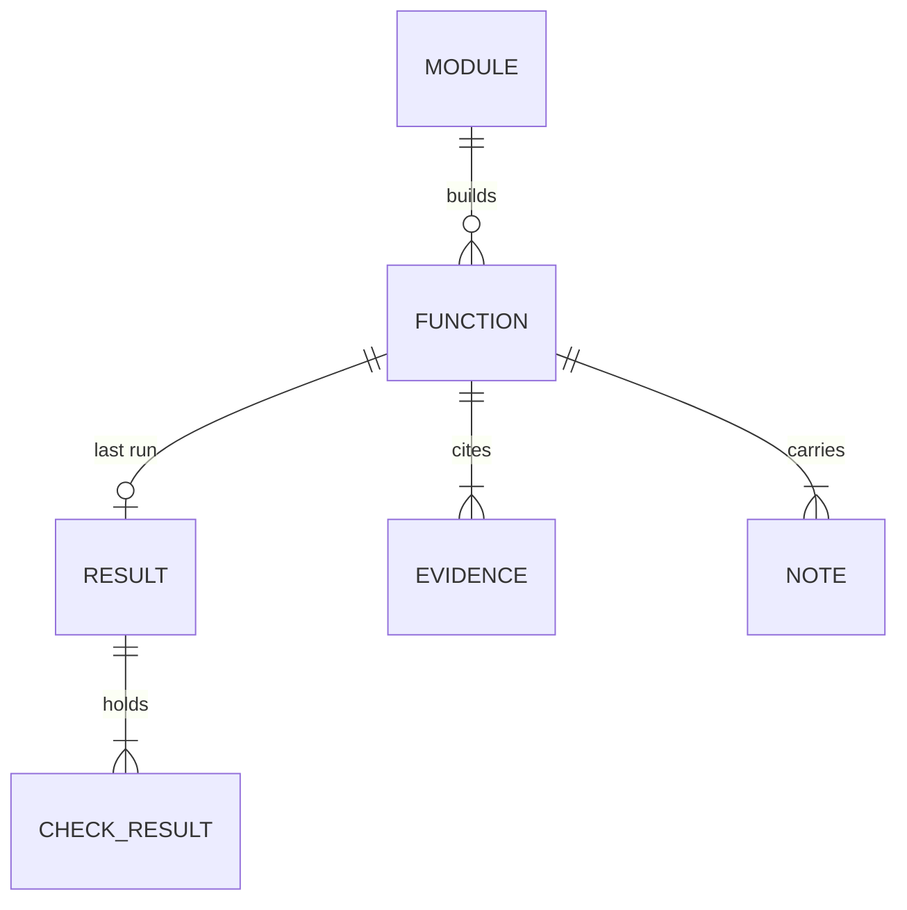
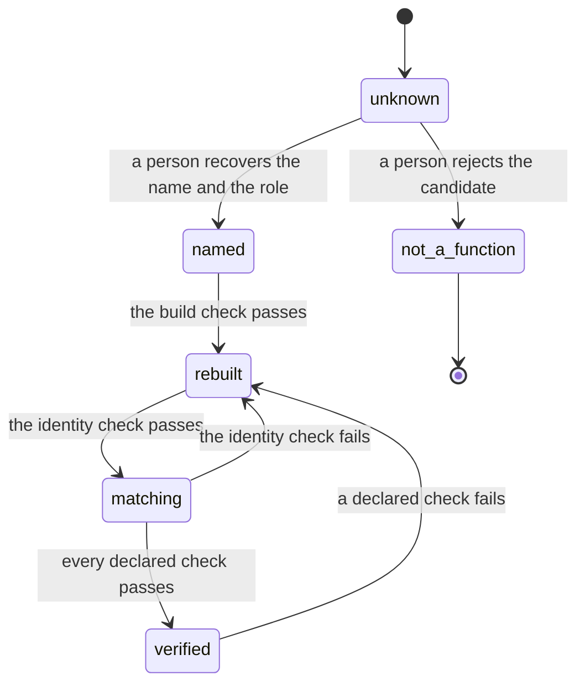
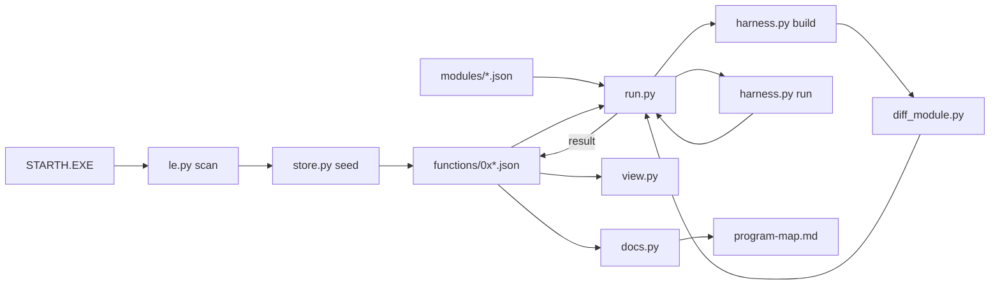

# Rebuild Instrumentation — Data Model

The store holds two record kinds: a function record per candidate and a
module record per build unit. Both live in git as JSON.

## Relationships

## Function Record

Path: `tools/rebuild/functions/0x<address>.json`. The file name is the
module linear address, so a recovered name never renames a file.

| Field | Type | Required | Rule |
| --- | --- | --- | --- |
| `address` | string | yes | `0x` and lowercase hex. Equals the file name. |
| `object_offset` | string | no | `0x` and lowercase hex. From `le.py`. |
| `size` | int | no | The byte count of the original body. The seed derives it as the distance to the next candidate, so it is an upper bound. Absent for the last candidate. |
| `name` | string | no | The recovered name. Absent when the candidate is unnamed. |
| `role` | string | no | One sentence. The view and the call-site table of the page show it. |
| `status` | string | yes | One value of the status ladder. |
| `confidence` | string | no | `observed`, `derived`, or `inferred`. |
| `section` | string | no | A section name of `program-map.md`. |
| `module` | string | no | The name of a module record. |
| `symbol` | string | no | The linker map symbol, for example `free_`. |
| `count` | int | no | The instruction count of the identity check, passed to `diff_module.py --count`. Set when the body sweep runs past the end of the function, for example `exit_flush` at `0x300d6`, which ends in a tail jump. |
| `checks` | list[string] | yes | A subset of `build`, `identity`, `behavior`. |
| `evidence` | list[object] | yes | See the evidence entry. |
| `notes` | list[object] | yes | See the note entry. |
| `result` | object | no | The last run. See the result entry. |

An optional field is absent, never null. The file stays small, and the diff
of a new value is one added line.

### Evidence Entry

| Field | Type | Rule |
| --- | --- | --- |
| `kind` | string | `command`, `finding`, `file`, or `note`. |
| `text` | string | A command, a heading of `findings.md`, a repository path, or one sentence. |

The render writes the `note` evidence entries into the `Evidence` column of a
function table, one per line. The `command`, `finding`, and `file` entries appear
in the detail pane of the view. The `role` appears in the detail pane and in the
call-site table of the page.

### Note Entry

| Field | Type | Rule |
| --- | --- | --- |
| `date` | string | `YYYY-MM-DD`. |
| `text` | string | ASD-STE100 prose. |

### Result

The result holds the evidence of the last run. The store never holds a
hand-entered percentage.

| Field | Type | Rule |
| --- | --- | --- |
| `date` | string | `YYYY-MM-DD`. |
| `command` | string | The exact command that ran. |
| `tool` | string | The tool and its version. |
| `source_digest` | string | `sha256:` over the sorted source files of the module. |
| `checks` | object | One check result per declared check. |

### Check Result

| Field | Type | Rule |
| --- | --- | --- |
| `verdict` | string | `pass` or `fail`. |
| `instructions_equal` | int | The `identity` check only. |
| `instructions_total` | int | The `identity` check only. |
| `bytes_equal` | int | The `identity` check only. |
| `bytes_total` | int | The `identity` check only. |
| `detail` | string | The verdict line of `diff_module.py`. |

## Module Record

Path: `tools/rebuild/modules/<name>.json`. The record holds the build
and run recipe, so the framework replaces the twenty shell scripts.

| Field | Type | Required | Rule |
| --- | --- | --- | --- |
| `name` | string | yes | Equals the file name. |
| `exe` | string | yes | The linked executable under `work/rebuild/`. |
| `map` | string | no | The linker map under `work/rebuild/`. Absent for the driver, which links without a map. |
| `sources` | list[object] | yes | See the source entry. |
| `run` | object | no | See the run entry. |
| `status` | string | no | The ladder. Set for a module that holds no function record, for example the driver. |
| `checks` | list[string] | no | The declared module checks, as in the function record. |
| `result` | object | no | The last run of the module checks. The same shape as the result of a function record. |

### Source Entry

| Field | Type | Rule |
| --- | --- | --- |
| `file` | string | A file under `tools/rebuild/`. |
| `compiler` | string | `wcc386` or `wasm`. |
| `flags` | list[string] | The flags of this file, for example `-of+`. |

The shared harness sources (`chk.asm`, `stack.asm`, `cstart.c`) are constants
of `harness.py`, not fields of a module record.

### Run Entry

| Field | Type | Rule |
| --- | --- | --- |
| `command` | string | The command line inside DOSBox-X. |
| `output` | string | The captured output file under `work/rebuild/`. |
| `expect` | list[string] | Every line must appear in the output. |
| `timeout` | int | Seconds. |

## Validation Rules

`store.py check` proves these rules and reports every violation.

1. The file name equals the `address`.
2. The `status` is a value of the ladder.
3. `named`, `matching`, and `verified` require a `name`.
4. `rebuilt`, `matching`, and `verified` require a `result`.
5. `verified` requires a passing `identity` check in the result.
6. Every declared check has one check result in the last result.
7. The `module` names an existing module record.
8. The `symbol` is set when the `module` is set.
9. `checks` is a subset of `build`, `identity`, and `behavior`.
10. An evidence entry of kind `finding` names a heading of
    `findings.md`.
11. An evidence entry of kind `file` names an existing path.
12. The stored status is not stronger than the last result supports.
13. A function record that declares `identity` requires a `module`, and
    that module record requires a `map`.
14. A module record with a `status` above `named` requires a `result`.

`test_store.py` also compares the property names and the required set of
every record with `tools/rebuild/contracts/record.schema.json`, so the contract
cannot drift from the store.

The render sorts the rows of a function table by address. The startup table
keeps the `STARTUP_STEPS` order, which is the step order of the page and not
the address order.

## The Identity Check

`run.py` reads the verdict of the identity check from the last line of the
`diff_module.py` output and from its exit code.

| Diff Result | Identity Verdict |
| --- | --- |
| `byte-identical` | `pass` |
| `the instruction sequences match; the differing operands are the link-time addresses` | `pass` |
| `the same instructions in a different order` | `pass` |
| `the instruction sequences differ` | `fail` |
| `the rebuilt module holds one instruction the original does not` | `fail` |
| `the original holds one instruction the rebuilt module does not` | `fail` |
| `the instruction counts differ` | `fail` |

The check result holds the verdict line in `detail`.

## Module-Level Checks

A module that holds no function of `STARTH.EXE` carries its own status,
checks, and result. The driver is the one case today.

- The driver holds no map, so `diff_module.py` cannot diff it. The
  reference is the byte sequence at offset `0x14157` of `HMIMDRV.386`, and
  `HMIMDRV.386` is not an LE image.
- The driver record declares the `behavior` check only, so it can reach
  `verified`.
- `run.py --module driver` selects the module row, and the progress line
  reads `[1/1] driver: PASS (behavior)`.
- The driver row appears in the view and not in `program-map.md`, because
  the program map covers `STARTH.EXE`.

## Status Ladder

The ladder is ordered. A run advances a record. A person sets the first three
statuses.

| Status | Meaning | Set By |
| --- | --- | --- |
| `unknown` | A candidate from the scan, nothing recovered | Seed |
| `not_a_function` | The scan false positive, terminal | A person |
| `named` | The name and the role are recovered | A person |
| `rebuilt` | A source exists and it builds | `run.py` |
| `matching` | The instruction sequences match | `run.py` |
| `verified` | Every declared check passes, `identity` included | `run.py` |

The advance of a run:

| Condition | New Status |
| --- | --- |
| A declared check is a skip | No write. A skip is not a pass. |
| The build check fails | No write. The record keeps its status. |
| The build check passes, and no identity check is declared | `rebuilt` |
| The identity check fails | `rebuilt` |
| The identity check passes, and a declared behavior check fails | `matching` |
| Every declared check passes, and `identity` is declared | `verified` |

The rules are exclusive in this order. A record with `checks = [identity]` and a
passing identity check reaches `verified`, because the behavior check is not
declared.

## Derived Values

The view derives both values. The store never holds them.

| Value | Rule |
| --- | --- |
| Instruction match | `instructions_equal / instructions_total`, as a percentage. |
| Byte match | `bytes_equal / bytes_total`, as a percentage. |
| Undefined | `—` when the record has no result or a zero total. |
| Stale | True when the record has a result and `source_digest` differs from the digest of the current module sources. |
| Stale sort order | Instruction match first, then byte match. |

## Seed Rules

1. `store.py seed` scans `STARTH.EXE` with the prologue scan of
   `le.py`. It passes a limit above the candidate count, because the
   default limit of `le.py funcs` is 500 and caps the total. The count 642
   in `findings.md` needs the raised limit.
2. The seed adds the entry address `0x300f8` and the exit helper `0x300d6`,
   which the prologue scan does not find, because neither holds an EBP frame:
   the entry holds a jump and the helper starts with a register save.
3. The seed derives `size` as the distance to the next candidate address.
   The distance is an upper bound, because the scan does not validate an
   instruction boundary. The last candidate holds no `size`.
4. The seed writes one record for each new candidate. It never rewrites an
   existing record.
5. A candidate the scan no longer finds stays in the store. The seed
   reports it.
6. A candidate that is not a function start becomes a `not_a_function`
   record with a note, so the scan noise is recorded knowledge.
7. The file set is the canonical candidate list, so the total is a file
   count. The seed reports the added and the lost candidates, so the total
   changes only through a reviewable diff.

## Data Flow

1. `le.py` decodes the code object of `STARTH.EXE` and reports the
   candidate starts.
2. `store.py seed` writes a record for each new candidate, and the
   one-time import folds in the hand-written rows of `program-map.md`.
3. `run.py` selects the records, reads the module record of each one,
   and calls `harness.py` to build the module.
4. `harness.py build` copies the sources into `work/rebuild/`, compiles
   them with the recipe, and links the executable and the map.
5. `run.py` calls `diff_module.py` with the map and the `symbol` of the
   record, and it reads the verdict and the counts.
6. `harness.py run` drives the DOSBox-X harness for a declared behavior
   check and compares the output with the `expect` lines.
7. `run.py` writes the result through `store.py`, prints the progress
   line, and keeps the full log under `work/rebuild/logs/`.
8. `view.py` renders the page from the store, and `docs.py` renders the
   tables of `program-map.md` from the store.
