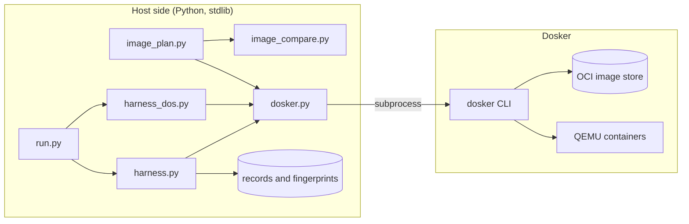

# DOSker Integration for the Reconstruction — Design

- **Date**: 2026-11-23
- **Status**: Approved
- **Input**: Brainstorm how the Dosker container system can serve the reproduction instrumentation of the Screamer reconstruction.

## Index

| Asset | Path | Purpose |
| --- | --- | --- |
| Design document | `docs/explanation/dosker-integration.md` | This document |

The diagrams are inline. The design needs no other asset.

## Context And Problem

The reconstruction needs a repeatable environment for three jobs:

1. Build a rebuilt function with OpenWatcom V2.
2. Build a rebuilt function with the period Watcom C/C++ 10.0a.
3. Run a built module or the rebuilt image and compare the behavior.

The project does these jobs with two ad-hoc paths:

- `tools/rebuild/harness.py` starts a pinned Docker image
  (`arlaneenalra/watcom-docker`, pinned by digest in the tool) for the V2
  build. It starts DOSBox-X for the run.
- `tools/rebuild/harness_dos.py` starts DOSBox-X for the period build. It
  writes the compile lines into the `[autoexec]` block and polls for the
  output file.

The two paths repeat environment handling. Neither path declares the
environment in a file. Neither path can build the whole image. The module run
also depends on `work/rebuild/DOS4GW.EXE`, and no tool creates that file. A
person copies it by hand.

Dosker supplies most of the missing parts. It is a container system for DOS.
It stores images in an OCI layout and caches the builds. A `Doskerfile`
declares the environment. `dosker exec` runs a guest command through a serial
agent and returns the guest exit code and the captured output. `dosker cp`
moves files. A named volume and a bind mount attach data. A serial log and an
engine log record the run. Dosker 0.1.5 is in use. The owner of this
reconstruction also owns Dosker, so the design can request small features.

## Goals And Non-Goals

### Goals

- **G1**: Declare the V2 build environment, the 10.0a build environment, and
  the run environment in Doskerfiles.
- **G2**: Build and run a module through one stdlib client, with the current
  interface and exit codes.
- **G3**: Build a whole `STARTH.EXE` from the rebuilt units, then report the
  byte coverage against the shipped image.
- **G4**: Record the future uses of Dosker: the instrumentation API, the
  differential tests, the snapshots, and the image distribution.

### Non-Goals

- The design does not move the debugger probes (`entry_probe.py` and
  `member_probe.py`) in this phase. Section _Future Extensions_ describes that
  work.
- The design adds no VM snapshot and no deterministic replay.
- The design does not run the whole game with CD audio. Dosker has no CD-ROM
  support. The roadmap replaces the CD audio path in M4.
- The design adds no Python dependency. The tools use the standard library
  and one subprocess boundary.
- The design does not change the check counts (303, 299, 288, 284).
- The design does not port the game to a modern platform.

## Requirements

### User Scenarios

#### Build One Module (Priority: P1)

A developer runs the V2 build for one module. The tool builds the image when
it is absent, starts one container, sends the build batch, copies the EXE and
the MAP back, and stops the container.

**Acceptance Scenarios**:

1. **Given** the Dosker image store holds the V2 image, **When** the
   developer runs `harness.py build --module free --backend dosker`, **Then**
   `work/rebuild/free.exe` and `work/rebuild/free.map` exist and the identity
   check gives the same verdict as the Docker path.
2. **Given** Docker is absent and Dosker is present, **When** the developer
   runs the same command, **Then** the build succeeds.
3. **Given** Dosker is absent, **When** the developer runs the same command,
   **Then** the tool prints a skip and exits with code 3.

#### Run One Module (Priority: P1)

A developer runs a built module. The tool starts the run image, sends the run
command, copies the output file back, and checks the markers.

**Acceptance Scenarios**:

1. **Given** `work/rebuild/free.exe` exists, **When** the developer runs
   `harness.py run --module free --backend dosker`, **Then** the tool reports
   the same markers as the DOSBox-X path.
2. **Given** the run command exits with a guest code other than zero,
   **When** the markers are present, **Then** the check passes and the result
   records the exit code.

#### Full Record Run (Priority: P1)

The maintainer runs the declared checks for every record.

**Acceptance Scenarios**:

1. **Given** the images are ready, **When** the maintainer runs
   `run.py run --all --skip-unchanged --backend dosker`, **Then** the
   verdicts match the stored results, the builds use bounded batches, and the
   behavior runs use one session per module.
2. **Given** the run finishes, **Then** the check count stays at 303 for the
   full check.

#### Whole-Image Coverage (Priority: P2)

The maintainer builds the whole image and reads the coverage.

**Acceptance Scenarios**:

1. **Given** the link plan lists the rebuilt modules, **When** the maintainer
   runs `image_plan.py build`, **Then** `work/rebuild/STARTH.EXE` and
   `work/rebuild/STARTH.MAP` exist.
2. **Given** the image exists, **When** the maintainer runs
   `image_compare.py --original … --rebuilt … --coverage`, **Then** the tool
   prints the linked bytes and the gap bytes per region and exits with code 1.

#### First-Time Setup (Priority: P2)

A contributor prepares the environments.

**Acceptance Scenarios**:

1. **Given** a host with QEMU and the pinned inputs, **When** the contributor
   runs `dosker_setup.py`, **Then** the tool builds the four images, prints
   their tags and digests, and records the digests in
   `work/dosker/images.json`.
2. **Given** the images exist and their digests match, **When** the
   contributor runs the setup again, **Then** the tool builds nothing.

### Functional Requirements

- **FR-001**: `harness.py` and `harness_dos.py` MUST keep their command line,
  their exit codes (0, 1, 2, 3), their artifact names, and their result
  records.
- **FR-002**: One stdlib client MUST hold every call to the `dosker` binary.
  No other tool MUST call the binary.
- **FR-003**: The client MUST check the Dosker version against a pinned
  constant. A mismatch MUST fail with a clear message.
- **FR-004**: The toolchain MUST live in the named volumes
  `screamer-watcom-v2-tools` and `screamer-watcom10-tools` (256 MiB each).
  The run image is `screamer-run:1`. The image names MUST be flat, because
  Dosker 0.1.5 rejects a name that holds a slash.
- **FR-005**: The setup tool MUST create an absent volume, copy the toolchain
  into it, reuse a present volume, enforce the 8.3 name rule, and record the
  digests.  The 8.3 check is case-insensitive, because the V2 tree uses
  lowercase names.
- **FR-006**: The build adapter MUST stage the sources with 8.3 names, write a
  `BUILD.BAT` batch file and a `LINK.RSP` response file, copy them into
  `C:\WORK`, run the batch with `dosker exec`, and copy the EXE and the MAP
  back. The batch sets `WATCOM=D:\WATCOM` on the toolchain volume.
- **FR-007**: The build adapter MUST write no file into a live bind of the
  host tree. It MUST use the sync bind fallback or a container copy.
- **FR-008**: `run.py` MUST own the sessions and stop each one in a `finally`
  block. A build session MUST cover at most 25 modules. A behavior session
  MUST cover one module. A harness call without a session name MUST start and
  stop its own container.
- **FR-009**: The client MUST reject a staged name that is not 8.3 and a
  command longer than 127 characters before it starts a container.
- **FR-010**: The run session MUST copy the shipped `DOS4GW.EXE` beside the
  module EXE and MUST record its SHA-256 digest. The shipped extender is the
  only supported one.
- **FR-011**: The run adapter MUST copy the run output to
  `work/rebuild/<output>` and apply the current marker rule.
- **FR-012**: Every build and run result MUST record the backend, the image
  tag, the image digest, the engine version, the agent version, the guest exit
  code, and the duration.
- **FR-013**: The whole-image tool MUST read a link plan from
  `tools/rebuild/link.json`.
- **FR-014**: The whole-image tool MUST report the linked code bytes, the code
  gap bytes, the data gap bytes, and the unmodeled regions.
- **FR-015**: `image_compare.py` MUST support a `--coverage` option. The
  option MUST print a per-region table with the status `identical`,
  `different`, `absent`, or `unmodeled`.
- **FR-016**: The pipeline MUST run the coverage report inside stage 11 when
  `work/rebuild/STARTH.EXE` exists. The check count MUST NOT change.
- **FR-017**: The two harnesses and `run.py` MUST accept
  `--backend dosker|legacy`. `run.py` MUST pass the backend and the client
  options to each harness call. The default is `dosker`. The `legacy` value stays
  for one milestone.
- **FR-018**: The fingerprint MUST include `tools/rebuild/dosker.py`, the four
  Doskerfile digests, the image digests, and the pinned Dosker version.
- **FR-019**: The design MUST document the future uses and the Dosker feature
  each use needs.
- **FR-020**: The CI MUST install the pinned Dosker release and QEMU, cache
  the image store, and run the record checks on Linux x86_64. The macOS arm64
  run MUST stay a nightly job.

## Assumptions And Constraints

### Assumptions

- Dosker is an external release, pinned at 0.1.5. The Screamer tools do not
  change the Dosker source.
- The owner of the reconstruction can add features to Dosker. This design
  requests one addition (machine-readable output) and one release asset (the
  DOS agent binary).
- The 10.0a CD tree and the V2 DOS package use 8.3 names. The dry run
  confirms this for both trees.
- The DOS-hosted OpenWatcom V2 tools produce the same function bodies as the
  Linux container. They can place static data in a different order, so the
  full test EXE can differ. The migration gate compares the identity verdict
  and the behavior markers, not the test EXE bytes.
- The shipped game files that the run needs use 8.3 names. A staging list
  selects them.

### Constraints From Dosker 0.1.5

| Limit | Value | Effect on the design |
| --- | --- | --- |
| Agent command length | 127 characters | Put the compile and link lines in `BUILD.BAT`. |
| Default `exec` timeout | 30 seconds | Pass `--timeout` on every build and run. |
| Build `RUN` timeout | 300 seconds | The default is enough for one module. |
| Copy limit | 16 MiB per file | The toolchain uses an image. It does not use `cp`. |
| File names | 8.3 only | Stage every source and object with short names. |
| Build and named volumes | QEMU only | The build uses the QEMU engine. |
| Bind drives | D:, E:, F: only | Stage the module files on D:. |
| Live bind (`vvfat`) | Can corrupt the host tree | Set `DOSKER_NO_VVFAT=1` and use the sync fallback. |
| Image import | A raw disk only | Build images with `COPY` from a host tree. |
| Snapshots | None | Out of scope. |
| Sandbox | None | Use trusted inputs only. |

### Constraints From The Project

- The tools import the standard library only. The rule holds. The client uses
  `subprocess`.
- The tools read no hidden configuration. A path and a data root come from
  the command line.
- The tools write only under `work/` or an explicit output path.
- A harness output name stays within the 8.3 limit.
- `work/` is disposable.
- The full check reports 303 checks. The flag variants report 299, 288, and
  284.

### Dosker Change Requests

The design asks Dosker for two small changes:

| Request | Why | Fallback |
| --- | --- | --- |
| A `--format json` option on `images` and `inspect`. | The client needs the image digest and the engine version. Text parsing is brittle. | Parse the current text output and record the risk. |
| Publish `DOSKER.EXE` with the release. | The FreeDOS base build needs the agent. CI should not compile it. | Build the agent with the Linux OpenWatcom V2 in the setup tool. |

No other Dosker change is needed for this phase. The later options in
_Future Extensions_ list their own requests.

### Resolved Decisions

#### RD-001: The DOS-hosted V2 toolchain

- **Question**: does the DOS-hosted OpenWatcom V2 produce the same output as
  the pinned Linux container?
- **Evidence**: the Docker image runs OpenWatcom V2 beta, build `Oct 24 2026`
  (64-bit). The DOS package is the `2026-11-01` build (32-bit). The test
  built `free`, `memcpy`, `list_create`, and `ai_update` with both hosts, the
  same flags, and the same link order.
- **Results**:

| Module | Flags | Module body | Full test EXE | Verdict against the shipped image |
| --- | --- | --- | --- | --- |
| `free` | none | identical | byte-identical | same |
| `memcpy` | assembly | identical | byte-identical | same |
| `list_create` | `-of+` | byte-identical | differs outside the module body | same |
| `ai_update` | `-of+`, FPU assembly | 181 of 181 instructions equal, 14 link-time operands differ | differs outside the module body | same |

- **Cause**: the two compiler builds place static data in a different order.
  The linker then assigns different addresses. The instruction opcodes do not
  change.
- **Decision**: adopt the DOS-hosted V2 package as the checks toolchain. Do
  not require test-EXE byte identity.
- **Gate**: the identity verdict and the behavior markers must match the
  Docker path. The oracle masks the link-time data addresses, so a
  relocation-only difference passes `--strict`.
- **Full run**: 251 buildable modules built with no failure. 252 identity
  checks ran, because the `exit` module carries two functions. 0 verdict
  differences and 0 gate differences against the Docker baseline. 37 modules
  differ only in the byte-equal count, by 1 or 2 bytes, with the same
  instruction counts. `driver` is behavior-only and has no map.
- **Residual**: pin the DOS package by SHA-256 and record the compiler build
  in the result evidence. The behavior run is RD-003.
- **Finding**: `docs/explanation/findings.md`, "The DOS-hosted V2 build
  matches the Linux container for the function bodies".

#### RD-002: The 8.3 COPY dry run

- **Question**: does the `COPY` of the toolchain trees pass the Dosker 8.3
  rule?
- **Evidence**: the check applies the Dosker `normalize_name` rule to every
  path component: a stem of 1 to 8 characters, an extension of 1 to 3
  characters, and the allowed character set.
  - The cached DOS-hosted V2 tree: 1646 entries, 0 violations. The longest
    component is 12 characters.
  - The 10.0a CD ISO `WATCOM` tree: 5115 files in 324 directories, 0
    violations. The ISO has no Joliet supplementary volume and no Rock Ridge
    extension. `bsdtar` therefore extracts the primary 8.3 names.
- **Decision**: proceed with `COPY` for both trees. No name map is needed.
- **Guard**: the setup tool enumerates every name before it builds an image
  and fails with the offending path. This keeps a future input from failing
  deep in a build.
- **Finding**: `docs/explanation/findings.md`, "The toolchain trees pass the
  DOS 8.3 name rule".

#### RD-003: The behavior session

- **Question**: does one session serve many modules without state leaks?  Does
  the behavior run need long file names?
- **Evidence**: 252 module runs.  A 25-module session produced 24 false
  failures in the file tests.  One session per module produced 0 differences.
  With `lfn = false`, 26 file tests failed.  With `lfn = true`, they pass.
- **Evidence**: 250 behavior baselines, 249 pass and 1 fail.  0 verdict
  differences.  The `error_report` baseline fails, because the output lacks
  `D`.  The DOS run also fails, but it stops with a DOS/4G general protection
  fault and holds no marker.  The module is `matching`, and the verdict
  matches.
- **Evidence**: the 2 records without a behavior check, `exit_flush` and
  `dpmi_int31_entry`, pass.  The `driver` module passes.
- **Decision**: run one fresh session per module.  Enable long file names.
  Put the shipped `DOS4GW.EXE` beside the module EXE.  The extender does not
  load from `PATH` for these stubs.
- **Finding**: `docs/explanation/findings.md`, "The full behavior run matches
  the baseline".

#### RD-004: The toolchain volume

- **Question**: can the V2 toolchain live in the image?
- **Evidence**: the FreeDOS base is 32 MiB and the V2 toolchain is 121 MiB.
  The build of `COPY toolchain/ C:\WATCOM` plus `RUN CHECK.BAT` fails at the
  `RUN` with `cannot write C:\WATCOM\BINW\VI.HLP: No space left on device`.
- **Evidence**: the `screamer-watcom-v2-tools` volume (256 MiB) holds the
  tree at `WATCOM`. The FreeDOS base exposes the first added volume as `D:`,
  although `dosker run -v NAME:E:` records `E:`.
- **Decision**: the toolchain is a named volume. The build image is the
  FreeDOS base. The setup copies the tree with `mcopy`.
- **Decision**: image and container names are flat. The image name pattern is
  `[a-z0-9][a-z0-9_.-]{0,62}`. A slash is invalid.

#### RD-005: The FreeDOS DOS/4GW boundary

- **Question**: does the behavior run work in the Dosker FreeDOS base?
- **Evidence**: the shipped `STARTH.EXE` with the shipped `DOS4GW.EXE` runs in
  the base and prints `Files damaged. Re-install Screamer.`  The game starts.
  A V2-built test EXE (`free.exe`, byte-identical to the Docker build) fails
  with `DOS/4GW fatal error (1012): ... is not a WATCOM program`, with the
  shipped 1.95 extender and the V2 1.97 extender.  The same files run in the
  host DOSBox-X.
- **Evidence**: the DOSBox-X 2026.10.01 binary embeds a DOS/4G 2.01a
  extender at file offset `0x7cfc67`, 353,668 bytes, SHA-256
  `87cb2fb20a83adde247e08b2dd98c3001392e7f5cca1faa17277ccd75186b919`.  The
  extracted extender runs the test EXE in the FreeDOS base and prints the 4
  markers.  The DOSBox-X internal DOS uses the same 2.01a; that is why the
  host run passed.
- **Decision**: the setup extracts the 2.01a from the pinned DOSBox-X.  The
  Dosker behavior run copies the 2.01a beside the test EXE.  The default
  Docker backend keeps the DOSBox-X behavior run.
- **First module**: `run.py run --function 0x300ec --backend dosker
  --no-write` passes. The build is the Dosker V2 volume. The identity is 3 of
  3 instructions and 6 of 9 bytes, the stored verdict. The behavior finds the
  4 markers in the Dosker FreeDOS base with the 2.01a.

## Approaches Considered

### Dosker Is The Engine, Screamer Keeps The Contract — Recommended

- **Summary**: Add one stdlib client and four Doskerfile environments. The
  harnesses keep their interface and delegate their internals. A
  `--backend dosker|legacy` switch gives one milestone of comparison. Delete
  the legacy path after the migration gate.
- **Trade-offs**: One environment model and one code path. The project drops
  Docker, the PTY handling, and the poll-for-file wait. It gains a dependency
  on a young tool and on the QEMU engine. The V2 toolchain host changes, so a
  byte comparison is necessary.
- **Decision**: Chosen. It removes the duplication that the request names,
  and it gives the whole-image tool a real build substrate.

### Two Permanent Backends

- **Summary**: Keep Docker and DOSBox-X. Add Dosker as a second backend.
- **Trade-offs**: No regression risk. The cost is two code paths, two CI
  setups, and two documented contracts. The duplication stays.
- **Decision**: Rejected. The switch in the chosen approach gives the same
  comparison for one milestone without a permanent cost.

### Thin Wrapper First

- **Summary**: Leave the harness. Use Dosker only for the whole-image
  pipeline.
- **Trade-offs**: The smallest risk. The whole-image tool copies the build
  logic, and the build substrate is not replaced.
- **Decision**: Rejected. The request names the build substrate as the first
  target.

## Architecture

### Components

| Component | Responsibility | Depends On |
| --- | --- | --- |
| `tools/rebuild/dosker.py` | Hold every call to the `dosker` binary. Parse the result. Map the exit codes. | Python standard library |
| `tools/rebuild/dosker_setup.py` | Check the pin. Ensure the base. Create the V2 and 10.0a toolchain volumes. Extract the DOS/4G 2.01a. Record the digests. | `dosker.py`, mtools |
| `screamer-watcom-v2-tools` | The 256 MiB volume with the V2 tree at `D:\WATCOM`. | Dosker |
| `screamer-run:1` | The FreeDOS base plus the DOS/4G 2.01a extender. The setup builds it. | Dosker |
| `screamer-image:1` | The whole-image build environment. A later step. | Dosker |
| `tools/rebuild/harness.py` | Module build and run with the current interface. | `dosker.py`, `store.py` |
| `tools/rebuild/harness_dos.py` | Period build with the current interface. | `dosker.py`, `store.py` |
| `tools/rebuild/image_plan.py` | Link plan. Whole-image build. Coverage report. | `dosker.py`, `le.py`, `store.py` |
| `tools/rebuild/image_compare.py` | Region compare and coverage table. | `le.py` |
| `tools/rebuild/store.py` | Records, fingerprints, status. | None |

### Diagram



### Data Flow

1. `run.py` selects a record and calls `harness.py build`.
2. The harness reads the module recipe and stages the sources under
   `work/dosker/stage/<module>/` with 8.3 names.
3. The harness writes `BUILD.BAT` and `LINK.RSP`. The client starts the
   `freedos:1.3` base with the V2 volume on `D:`, then copies the files into
   `C:\WORK`.
4. The client runs `C:\WORK\BUILD.BAT`. The agent runs the batch through
   `COMMAND.COM` and returns the exit code and the output.
5. The client copies `C:\WORK\<EXE>` and the map into `work/rebuild/`.
6. `diff_module.py` and `oracle.py` compare the rebuilt body with the shipped
   body. The result goes through `store.py`.
7. For the behavior run, `run.py` starts one session per module. The harness
   stages the EXE and `DOS4GW.EXE` beside it, sets the work directory, runs
   the recipe command, and copies the output to `work/rebuild/<output>`. The
   session stops after the check.
8. For the image, `image_plan.py` reads `link.json`, compiles the modules in
   plan order, links them with the period runtime, and copies the image back.
9. `image_compare.py --coverage` compares the regions and prints the coverage.

## Component Interfaces

### `tools/rebuild/dosker.py`

- **Purpose**: The only boundary to Dosker.
- **Interface**:

```python
PINNED_VERSION = "0.1.5"

class ExecResult:
    exit_code: int
    output: str
    timed_out: bool

class DoskerClient:
    def __init__(self, binary: str, data_root: Path, work_dir: Path) -> None: ...
    def version(self) -> str: ...
    def image_digest(self, tag: str) -> str: ...
    def ensure_image(self, tag: str, context: Path) -> str: ...
    def start(self, tag: str, name: str, boot_timeout: int = 60,
              binds: Sequence[Bind] = (), volumes: Sequence[str] = ()) -> None: ...
    def exec(self, name: str, command: str, workdir: str = "C:\\",
             timeout: int = 30) -> ExecResult: ...
    def copy_in(self, name: str, host: Path, guest: str) -> None: ...
    def copy_out(self, name: str, guest: str, host: Path) -> None: ...
    def logs(self, name: str, kind: str = "container") -> str: ...
    def stop(self, name: str) -> None: ...
    def remove(self, name: str) -> None: ...

class Session:
    def exec(self, command: str, timeout: int = 30) -> ExecResult: ...
    def copy_in(self, host: Path, guest: str) -> None: ...
    def copy_out(self, guest: str, host: Path) -> None: ...
    def close(self) -> None: ...
```

- The client passes `DOSKER_ROOT` to the child as the data root.
- `Bind` is a tuple `(drive, host_path, read_only)`. The drive is `D:`, `E:`,
  or `F:`.
- The client passes `DOSKER_NO_VVFAT=1` to the child when a bind uses a host
  tree. It passes `DOSKER_QEMU` only when the caller sets it.
- `Session.close()` stops and removes the container only when the session
  owns the container. A named session belongs to the caller, so `close()`
  does nothing.
- The client sets a unique container name with a random suffix and removes
  the container in a `finally` block. A named session skips the random
  suffix. The owner of the name removes the container.
- `start` is idempotent for a named session. It inspects the record, starts
  the container when it is absent, and fails when the state is `Stopping` or
  `Exited`.
- **Failure Modes**: A missing binary raises `RuntimeError` with the expected
  path. A version mismatch raises `ValueError`. A failed command raises
  `RuntimeError` with the exit code and the last lines of the log.

### Harness Command Line Additions

| Tool | New option | Default | Purpose |
| --- | --- | --- | --- |
| `harness.py` | `--backend dosker\|legacy` | `dosker` | Select the environment. |
| `harness.py` | `--dosker PATH` | `dosker` from `PATH` | The binary. |
| `harness.py` | `--data-root PATH` | `work/dosker/root` | The Dosker store. |
| `harness.py` | `--qemu PATH` | `qemu-system-i386` from `PATH` | The engine program. |
| `harness.py` | `--session NAME` | absent | Attach to a container that `run.py` owns. The caller stops it. |
| `harness_dos.py` | `--backend`, `--dosker`, `--data-root` | as above | The same. |

The exit code map stays:

| Code | Meaning |
| --- | --- |
| 0 | Success. |
| 1 | Build failure, run failure, or a missing marker. |
| 2 | Missing record, missing recipe, or a bad argument. |
| 3 | The environment is absent (Docker, DOSBox-X, or Dosker). |

### Doskerfiles

The V2 toolchain is 121 MiB. The FreeDOS base is 32 MiB. A `COPY` of the
toolchain into the base fails at the `RUN` step with
`No space left on device` (RD-004). The toolchain stays in the
`screamer-watcom-v2-tools` volume:

```sh
python3 tools/rebuild/dosker_setup.py --toolchain PATH --toolchain10 PATH
```

The setup creates the two 256 MiB volumes, copies the V2 tree and the Watcom
10.0a tree into `::WATCOM` with `mcopy`, and records the digests in
`work/dosker/setup.json`.  The 10.0a compiler is `BINB/WCC386.EXE`.  The 8.3
check is case-insensitive; the V2 tree uses lowercase names and the mcopy
writes the uppercase names.  The FreeDOS base exposes the first added volume
as `D:`, so the build batch sets `WATCOM=D:\WATCOM`. `dosker run -v NAME:E:`
records `E:`, but the guest sees `D:` (RD-004).

The build container is the `freedos:1.3` base with the volume on `D:`. The
build copies the sources and the batch into `C:\WORK` and runs `BUILD.BAT`.
The behavior run uses the DOS/4G 2.01a extender that the setup extracts from
the pinned DOSBox-X.  The 2.01a accepts the V2 test stub in the FreeDOS base;
the shipped 1.95 and the V2 1.97 reject it with DOS/4GW error 1012 (RD-005).
The default Docker backend keeps the DOSBox-X behavior run.

The run image is `screamer-run:1`:

```doskerfile
FROM freedos:1.3
COPY extender/ C:/
RUN DIR C:\DOS4GW.EXE
```

The `RUN` projects the `COPY` tree onto the image disk.  Dosker 0.1.5
projects the image tree onto the container disk, so a run container sees the
image's `C:\DOS4GW.EXE`.  The setup builds this image and records its digest.
The run copies the module EXE to `C:\` and runs it there, beside the image's
`C:\DOS4GW.EXE`.

Rules:

- The `COPY` source is a context path with `/`. The destination is a DOS path.
- Do not end a Doskerfile line with `\`. The parser treats it as a line
  continuation. Use a file destination, or a destination without the trailing
  separator.
- A `COPY` of a tree needs a following `RUN` to reach the image disk.
- The 8.3 rule applies to every copied name (RD-002).

The setup tool records the input digests. It also confirms that
`freedos:1.3`, `DOSKER.EXE`, and the FreeDOS source are present. A missing
input stops the setup with the pinned URL and the expected SHA-256.

### Link Plan

`tools/rebuild/link.json`:

```json
{
  "version": 1,
  "toolchain": "screamer-watcom10:1",
  "engine": "qemu",
  "link_options": [
    "system", "dos4g",
    "option", "quiet",
    "option", "map=C:\\LINK\\STARTH.MAP"
  ],
  "runtime_libs": ["C:\\WATCOM\\LIB386\\DOS\\CLIB3R.LIB"],
  "order": ["main", "engine_interface_init", "race_loop"],
  "unmodeled": [
    {"start": "0x20000", "end": "0x21000", "kind": "code"},
    {"start": "0x21000", "end": "0x22000", "kind": "data"}
  ]
}
```

Rules:

- `order` lists module names in link order. The seed order comes from the
  shipped object layout and the record addresses.
- `unmodeled` lists the address ranges that no module covers. The ranges come
  from the gaps between the record extents. The example values are
  illustrative.
- `link_options` and `runtime_libs` come from the shipped build. A later step
  verifies them against the shipped image. The exact library names come from
  the CD tree, and the Open Questions record the check.

### `tools/rebuild/dosker_setup.py`

- **Purpose**: Prepare the base, the two toolchain volumes, and the DOS/4G
  2.01a extender once and record their identity.
- **Interface**:
  - `dosker_setup.py [--dosker PATH] [--data-root PATH] [--toolchain PATH]
    [--toolchain10 PATH] [--check]`
  - `--check` verifies the pin, the volumes, the extender, and the 8.3 names,
    and builds nothing.
  - Without `--check`, the tool creates a missing volume, copies a missing
    toolchain, and leaves a present volume alone.
- **Output**: `work/dosker/setup.json` with the base, the V2 volume, the
  10.0a volume, the `screamer-run:1` image, and the extender digests, and one
  line per environment.
- **Failure Modes**: A missing input prints the pinned URL and the expected
  SHA-256 and exits 2. A missing Dosker prints the release URL and exits 3.

### `tools/rebuild/image_plan.py`

- **Purpose**: Own the link plan, the whole-image build, and the coverage
  report.
- **Interface**:
  - `image_plan.py seed [--original PATH]` writes `tools/rebuild/link.json`
    from the shipped object layout, the record extents, and the shipped link.
  - `image_plan.py build [--check]` stages the modules, compiles them in plan
    order, links the image, and copies `STARTH.EXE` and `STARTH.MAP` into
    `work/rebuild/`.
  - `image_plan.py coverage [--original PATH]` writes
    `work/rebuild/image_coverage.json` and prints the table.
- **Failure Modes**: A missing plan, a missing image, or a link error exits
  1. An absent coverage region exits 1 and stays in the report.

## Data Model

| Entity | Location | Fields |
| --- | --- | --- |
| Image record | `work/dosker/images.json` | `tag`, `digest`, `dosker_version`, `inputs[]`, `built_at` |
| Build result | module record `result` | `backend`, `image_tag`, `image_digest`, `engine`, `agent_version`, `exit_code`, `duration_s`, `output_sha256` |
| Link plan | `tools/rebuild/link.json` | `version`, `toolchain`, `engine`, `link_options[]`, `runtime_libs[]`, `order[]`, `unmodeled[]` |
| Coverage report | `work/rebuild/image_coverage.json` | `total_bytes`, `code_linked`, `code_gap`, `data_gap`, `regions[]`, `verdict` |

The store stays the only writer of records. The new files are generated
output, and they stay out of git.

## API Contracts

### Result Evidence

A build result adds these fields to the existing `checks` object:

| Field | Type | Meaning |
| --- | --- | --- |
| `backend` | string | `dosker` or `legacy` |
| `image` | string | The image tag |
| `image_digest` | string | The OCI digest |
| `engine` | string | `qemu`, `dosbox-x`, or `bochs` |
| `agent_version` | string | The agent version |
| `exit_code` | integer | The guest exit code |
| `duration_s` | number | The wall time |
| `output_sha256` | string | The digest of the captured output |

### Coverage Verdicts

| Verdict | Meaning |
| --- | --- |
| `identical` | The region bytes match. |
| `different` | The region exists and the bytes differ. |
| `absent` | The rebuilt region is shorter or missing. |
| `unmodeled` | The plan marks the region as not rebuilt. |

## Error Handling And Edge Cases

| Condition | Exit | Action |
| --- | --- | --- |
| Dosker is absent | 3 | Print a skip with the release URL. |
| Dosker version differs | 1 | Stop and print the expected and actual versions. |
| The image is absent and the build fails | 1 | Print the failing Doskerfile line and the engine log tail. |
| The agent does not handshake | 1 | Print the boot timeout and the serial log tail. |
| `exec` returns 124 | 1 | Print the timeout, the command, and the partial output. |
| `exec` returns 125 | 1 | Print the container state and the container log tail. |
| A staged name is not 8.3 | 1 | Name the file and the rule. |
| A command exceeds 127 characters | 1 | Name the line and the limit. |
| A live bind would write to the host tree | 1 | Stop and require the sync fallback. |
| The artifact is missing after the batch | 1 | Print `BUILD.LOG` and the batch exit code. |
| The run output is absent | 1 | Print the run command and the guest output. |
| The whole image is absent | skip | Keep the stage 11 skip. |
| A coverage region is unmodeled | 1 | Report the region as a plan gap, not a build failure. |

## Security And Privacy

- Dosker does not sandbox an image. QEMU TCG is not a security boundary.
  Every input here is trusted: the shipped game, the two toolchains, and the
  project sources. The design adds no network service and no remote image.
- The child environment is explicit. The client sets only `DOSKER_ROOT`,
  `DOSKER_NO_VVFAT`, and an optional `DOSKER_QEMU`.
- The images hold no secret. The distribution holds no secret.
- The 10.0a CD image is abandonware. It stays local under `work/`. The host
  tree holds the extracted files.

## Non-Functional Requirements

- **NFR-001**: The record run with Dosker MUST take no more than twice the
  recorded Docker baseline. Measure the baseline before the default switch.
- **NFR-002**: A build MAY reuse one container for a batch of at most 25
  modules. A behavior run MUST start a fresh session per module, because a
  long session accumulates DOS state. The DOSBox-X behavior run MUST enable
  long file names, because the test harnesses use them.
- **NFR-003**: The output MUST print the image tag, the image digest, the
  engine command, and the guest exit code. A log file MUST hold the same
  facts.
- **NFR-004**: The build MUST be reproducible. The image timestamps are
  fixed. The migration test checks the compiler output for stable bytes. The
  result records the input digests.
- **NFR-005**: The tools MUST work on macOS arm64 (QEMU TCG) and Linux
  x86_64.

## Testing Strategy

- **Unit tests** in `tools/rebuild/tests/`:
  - A fake `dosker` program in a temporary directory. It reads the
    arguments and returns a chosen exit code.
  - Test the version check, the exit-code map, the 8.3 check, the 127
    character check, the `BUILD.BAT` text, and the link plan parse.
  - No Docker, no DOSBox-X, and no game directory.
- **Golden tests**: Compare the generated `BUILD.BAT`, the link response
  file, and the Doskerfile copies with pinned text.
- **Migration test** (`DOSKER_INTEGRATION=1`): Build `free` and three mixed
  modules with both backends. Compare the identity verdict against the shipped
  image and the behavior markers. A test-EXE byte difference alone does not
  block the switch, because the static data order can differ. Record the
  compiler builds and the results.
- **Image test** (`DOSKER_INTEGRATION=1`): Build the four images in a
  temporary data root. Record the digests. A second run MUST build nothing.
- **Tool checks**: Run each changed tool against the shipped artifacts. Run
  the syntax gate. Run `pipeline_check.py --skip-runtime --skip-cross` and
  compare the check count.
- **Pipeline**: The stage 11 whole-image check MUST print the coverage line
  when the image exists. The count stays at 303.
- **Behavior run**: Use one fresh session per module, the DOS/4G 2.01a
  extender beside the EXE, and long file names where the DOS supports them.
  Do not batch the behavior runs.

## Rollout And Compatibility

The phases are:

1. Add the client, the setup tool, and the four Doskerfiles.
2. Add `--backend` with the default `legacy`. Run the migration test.
3. Change the default to `dosker`. Keep `legacy` for one milestone.
4. Delete the Docker path, the DOSBox-X build path, and the direct DOSBox-X
   module run. Update `AGENTS.md`, `tooling.md`, and the finding.
5. Add the whole-image plan and the coverage report.

The compatibility rules are:

- A record result built by the legacy backend stays valid. The backend is
  evidence, not a status input.
- The fingerprint gains the client, the Doskerfiles, the image digests, and
  the version. The first run after the change re-verifies every record once.
- The status page shows the backend in the evidence. No new status value is
  added.

## Risks

| Risk | Impact | Mitigation |
| --- | --- | --- |
| A future V2 package moves the static data. | The test-EXE bytes differ. | Gate on the identity verdict. The oracle masks the link-time addresses. See RD-001. |
| A future toolchain input has a long name. | The image build fails. | The setup enumerates the names and fails early. The current inputs pass. See RD-002. |
| The toolchain exceeds the base image. | The `RUN` fails with no space. | Use the toolchain volume. See RD-004. |
| The FreeDOS base rejects the V2 DOS/4GW stub. | The behavior run fails. | The setup extracts the DOS/4G 2.01a from the pinned DOSBox-X; the 2.01a accepts the stub. See RD-005. |
| QEMU TCG boot time slows the record run. | Long CI runs. | Batch the builds. The behavior run boots once per module, as the Docker baseline does. Measure. Use a snapshot later. |
| A live bind corrupts the host tree. | Lost work. | Force the sync fallback. Reject a live bind in the client. |
| Dosker 0.1.5 is young. | A bug blocks the build. | Pin the release. Keep the change small. File the fix in Dosker. |
| The whole image has no data model. | The gate cannot pass. | Report coverage. Do not claim a pass. |
| CI cannot build the FreeDOS base. | No images in CI. | Cache the image store. Pin the agent binary and the FreeDOS ZIP. |
| The run needs the CD data. | The whole game does not run. | Defer to the CD audio work in M4. The module runs do not need it. |

## Open Questions

The former blocking questions are resolved in RD-001 to RD-005.

| Question | Owner | Resolution Path |
| --- | --- | --- |
| What is the image store size? | Maintainer | Measure after the setup. |
| Which game files does a whole-game image need? | Maintainer | The run test and the inventory. This is a later option. |
| Does the shipped link use the default run-time libraries? | Maintainer | Compare the 10.0a `WLINK` response and the shipped LE. |

## Success Criteria

- **SC-001**: `harness.py build --module free --backend dosker` gives the same
  identity verdict as the Docker path.
- **SC-002**: `harness.py run --module free --backend dosker` finds the same
  markers as the DOSBox-X path.
- **SC-003**: The record run passes all current verdicts and stays within two
  times the recorded baseline.
- **SC-004**: The full check still reports 303 checks, and the flag variants
  report 299, 288, and 284.
- **SC-005**: `image_plan.py build` writes `work/rebuild/STARTH.EXE` and the
  map, and `image_compare.py --coverage` prints the coverage table.
- **SC-006**: CI passes on Linux x86_64. The macOS arm64 run passes nightly.
- **SC-007**: The project adds no Python dependency and no hidden
  configuration.
- **SC-008**: `docs/reference/tooling.md`, `AGENTS.md`, and
  `docs/explanation/findings.md` describe the new path.
- **SC-009**: The setup name check passes the V2 DOS tree (1646 entries) and
  the 10.0a CD tree (5438 entries) with zero violations.
- **SC-010**: `run.py run --function 0x300ec --backend dosker --no-write`
  passes the build, identity, and behavior checks in the Dosker FreeDOS base.
- **SC-011**: `screamer-run:1` builds from the DOS/4G 2.01a extender, and the
  `--check` reports it present.

## Future Extensions

The request asks to record every proposed use of Dosker. This section holds
all of them. Each entry names the Dosker feature it needs.

| Option | What it gives | Dosker features needed | Screamer work | Phase |
| --- | --- | --- | --- | --- |
| Build and run substrate | One declared environment | `COPY`, `RUN`, `exec`, `cp`, images, volumes | This design | Now |
| Whole-image pipeline | Coverage of the shipped image | The build image and `exec` | `link.json`, `image_plan.py`, coverage | Now |
| Instrumentation API | Stable breakpoints and memory access | Debugger requests in the supervisor and the engine trait | Migrate the probes | Next |
| Differential testing | Behavior compare of original and rebuild | Paired containers, event capture, snapshots | A test harness and a trace format | Later |
| Snapshots and replay | Repeatable runs, cached build steps | qcow2 overlays, QMP `savevm`/`loadvm`, `-icount`, a fixed RTC | Use the new commands | Later |
| Image distribution | One command for a developer or player | `save`, `load`, a registry, a path to publish a tag | A booter image and docs | Later |
| Shared cache and registry | Fast CI and team builds | A registry or a shared store, signed images | CI wiring | Later |

### Instrumentation API

The current probes drive the DOSBox-X MCP socket from Python:

| Probe | Current mechanism | API form |
| --- | --- | --- |
| `entry_probe.py` | `BPINT 21 4B`, `EV`, `LOGS`, read `LOGCPU.TXT` | `Break(kind=int, vector=0x21, ah=0x4b)`, `Registers()`, `Trace(count)` |
| `member_probe.py` | INT3 patch, `EV`, `MEMDUMPBIN`, `SMV` | `Patch(addr, bytes)`, `Break(kind=int3)`, `Registers()`, `Memory(region)` |
| Cross-check session | `BPLM`, `BPPM`, `IV`, `screen` | `Break(kind=linear or selector)`, `ScreenText()` |

The API needs:

- New supervisor requests: `Break`, `Registers`, `Memory`, `Trace`,
  `Patch`, `Screen`.
- A new capability, `debug_script`, declared for DOSBox-X and QEMU.
- The DOSBox-X backend maps to the MCP commands. The QEMU backend maps to the
  GDB stub.
- A Python client that returns structured data instead of a screen dump.

The benefit is one API for both engines, no PTY, no free-port guess, and
repeatable addresses.

### Differential Testing

Run the shipped game and the rebuilt image in two containers from the same
snapshot and the same input. Capture:

- the guest output;
- the opened files (agent hook or DOS interrupt trace);
- the screen frames (a frame digest);
- the sound buffer digest;
- the input timeline.

The design needs snapshots, a fixed RTC, and `-icount` for repeatable timing.
It also needs the CD audio path, because the shipped game reads the CD. The
whole-image pipeline (G3) is the prerequisite for the rebuilt side.

### Snapshots And Replay

Dosker needs a snapshot command. The QEMU adapter already has a QMP client
with a general `execute` call, so `savevm` and `loadvm` need a qcow2 disk and
a new supervisor request. A deterministic mode needs `-icount`, a fixed RTC,
and a recorded input stream. The benefit is a cached build step and a
repeatable test.

### Whole-Image Completion

The current store holds 935 function records: 30 `verified`, 1 `matching`,
221 `rebuilt`, 31 `named`, and 652 `unknown`. It holds 262 module recipes.
The records cover code functions only. A byte-identical image needs:

- the data objects and the string table;
- the import and fixup tables;
- the exact link order;
- the run-time libraries;
- the Watcom run-time objects.

The link plan schema has the fields for this work. The store needs a data
record type before the plan can cover data.

### Image Distribution

A `screamer:latest` booter image lets a developer or a player run the game
with `dosker run`. Dosker needs a registry and a signed image. The CD audio
gap remains, and the roadmap M4 replaces it.

### Shared Cache And Registry

CI and the team can share the image store. Dosker needs a registry protocol
or a shared data root. The images hold no secret, so a read-only mirror is
enough to start.
